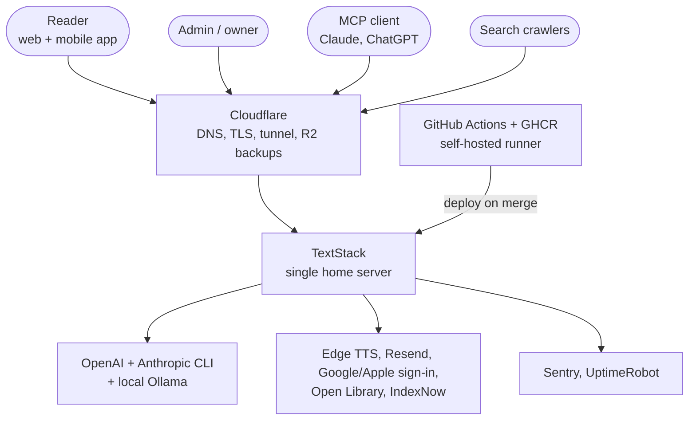
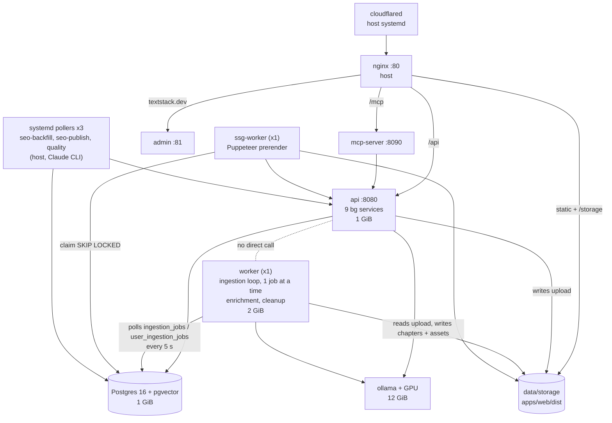
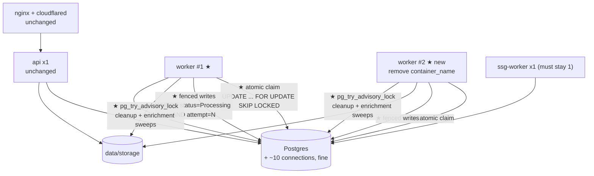

# C4: how the system runs today, and what a second worker would take

Verified against code, `docker-compose.yml` and the production host on 2026-10-23. Diagrams are Mermaid (same
convention as [flows.md](flows.md)). Companion to [ADR-022](adr/ADR-022-one-consumer-per-queue.md) and
[ADR-023](adr/ADR-023-single-instance-no-fire-and-forget.md), which make the single-consumer rule deliberate.

**Short answer.** One worker handles the load with room to spare, and a second copy on the same machine adds speed
nobody needs and no availability. The invariant is now enforced (`SingleInstanceLock`), not just assumed.

## Measured (production, 2026-10-22)

| | |
|---|---|
| Host | one home server: Ryzen 5 4600H (6c/12t), 30 GiB RAM, disk 82% used, GTX 1650 Ti for Ollama |
| Worker container | 69 MiB idle, 2 GiB cap |
| Catalog ingestion (25 jobs) | p50 0.9 s, p99 6.6 s, max 6.8 s |
| User uploads (95 jobs) | p50 3.4 s, p99 48 s, max 74 s |
| Capacity of one worker | about 1000 books/hour at the median, about 48/hour if every job were the 74 s worst case |
| Metrics export | none in production (`OTEL_EXPORTER_OTLP_ENDPOINT` unset); stuck jobs reach Sentry as errors |

## L1 — System context

## L2 — Containers, today

The API and the worker never call each other. They meet only in Postgres tables and the shared `data/storage`
mount. That is why the worker's queue claims are the thing a second copy would break.

## L2 — If we ever add a worker replica (not planned)

★ marks work that must exist first. Without it a second worker corrupts data.

What each ★ protects against (found by reading the code, not by running two workers):

| Piece | Without it |
|---|---|
| Atomic claim | both copies read the same Queued job and both run it; the loser's catch overwrites the winner's `Succeeded` with `Failed` and leaves orphan files |
| Fenced writes | a slow copy whose lease expired still writes over the copy that re-claimed the job; user-upload asset cleanup can delete the other run's files |
| Lease at least as long as the longest job, or a heartbeat | a job still running is re-picked by the other copy (user uploads: 2 min lease) |
| Enrichment window | a run longer than 10 min is reset to Pending and enriched twice (paid OpenAI calls) |
| Locked sweeps | guest cleanup and the optional watcher run twice (noisy, not harmful) |
| `SingleInstanceLock` removed or made per queue | today it deliberately blocks a second copy |

Also needed: a real-Postgres test fixture (none exists; the integration suite is HTTP against a live server), compose
without `container_name` on the worker, and a new ADR superseding 022/023.

A replica on the same machine does not improve availability: the worker already restarts itself
(`restart: always`), and the single point of failure is the host, the tunnel and the database. Real availability
means a second host, which is a different project. The API is a larger problem than the worker (its nine
background services have no locks), so a second API replica is out of scope here.

## When to revisit

Queue wait stays above one to two minutes for real users, a job approaches its lease, or an availability
requirement appears. Until then the cheapest correct state is the current one.

## Resolved while drawing this

`infra/nginx/textstack.conf` has `location /ssg/ { alias .../data/ssg/; }`, and its comment says SSG output lands in
`data/ssg/`. On the host (2026-10-23) `data/ssg/` does not exist; the pages are in `apps/web/dist/ssg/`, which is
what compose mounts into the ssg-worker. Bots still get them because `try_files $ssg_file` resolves
`/ssg/<uri>/index.html` against the nginx root (`apps/web/dist`) directly; the `/ssg/` alias location is never
reached. So the alias and its comment are stale but harmless. Removing them is a nginx change (it deploys to
production), so it is left for whoever next touches that file.
