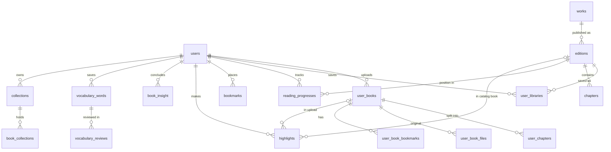

# Data Model

The one map of the PostgreSQL schema: every table, what it is for, and what happens to it next.
Column-level truth: [`database/migrations/`](../../database/README.md) — the baseline plus every
numbered migration after it ([ADR-026](adr/ADR-026-sql-first-migrations.md)). Audited 2026-10-26 for the
database cleanup ([#926](https://github.com/mrviduus/textstack/issues/926)).

**Update this page in the same PR as any schema change.** A PR that adds, drops or reshapes a table
changes its row here.

## Numbers (2026-10-26)

| | |
|---|---|
| Tables | 62 (61 `DbSet`s + the `edition_genres` join); `notes` dropped by `0005` |
| Migrations | SQL since 2026-10-26: `0000_baseline` stands for the 147 EF Core migrations production had applied (`20251217180704_Initial_WorkEdition_Admin` → `20261024202404_TranslateRegistryOnGpt41Mini`), which were then deleted. The 148th, `20260219000000_AddSearchPerformanceIndexes`, had no `.Designer.cs` and never ran; its indexes turned out unusable by search, closed not-planned ([#948](https://github.com/mrviduus/textstack/issues/948)) |
| SQL baseline | [`database/migrations/0000_baseline.up.sql`](../../database/migrations/0000_baseline.up.sql): this whole schema, grouped and numbered as below, + seed rows ([#931](https://github.com/mrviduus/textstack/issues/931)); builds a schema identical to production |
| Ledger | `schema_migrations` (not in the inventory: the runner's, not the app's). EF Core's `__EFMigrationsHistory` dropped by `0001` ([#961](https://github.com/mrviduus/textstack/issues/961)) |
| Indexes | 167 after `0005` (baseline 181: keys + raw-SQL indexes + 145 `HasIndex`, 133 now) |
| Site-scoped | 23 tables carry `site_id` + an EF query filter (single site forever, [ADR-007](adr/007-single-domain-consolidation.md)) |
| Objects outside the EF model | extensions `pg_trgm`, `vector`; `get_fts_config()` + `chapters` search-vector trigger; generated `user_chapters.search_vector` — in the baseline like everything else. The GiST trigram index on `lower(editions.title)` was dropped by `0002` (no query used it, #948) |
| Largest | `chapters` 2.6 GB · `llm_traces` 790 MB (3,852 rows) · `user_chapters` 131 MB · `lint_results` 30 MB |

## Status legend

| Status | Meaning |
|---|---|
| **Keep** | Live, no known problem |
| **Clean** | Live; dead columns, redundant indexes or missing constraints to fix (listed in Notes) |
| **Retire** | Dead or replaceable; drop in the cleanup |
| **Decide** | Live but duplicated or questionable; needs a design decision before V2 |
| **Site** | Goes away with the single-site cleanup |
| **Dropped** | Gone from the schema; row kept so the numbering stays stable |

Rows: exact `count(*)` in production on 2026-10-26 (`pg_stat_user_tables` estimates were stale — `chapters` read 0).

## Inventory

### Catalog — admin-curated public library, SEO, prerender

| # | Table | Purpose | Status | Notes | Rows |
|---|---|---|---|---|---|
| 1 | `sites` | The one site's settings | Site | Live: `primary_domain`, `default_language`, `indexing_enabled`, `sitemap_enabled` → config. Dead: `theme`, `ads_enabled`, `features_json` (sent to clients, never read) | 1 |
| 2 | `site_domains` | Host → site lookup | Site | `is_primary` never read; unknown hosts already fall back to the one site | 4 |
| 3 | `works` | Language-neutral book (slug only) | Decide | 1:1 with `editions` (1,433 each in prod); merge into `editions`. Possible duplicate-title upload collision (`AdminService.Upload.cs:52`) | 1,433 |
| 4 | `editions` | A published book: title, cover, SEO fields, status | Clean | `source_edition_id` always null (+ index); `canonical_override` edited in admin, read nowhere | 1,433 |
| 5 | `chapters` | Chapter HTML, plain text, `search_vector` (trigger) | Keep | `(edition_id, slug)` index not unique though slug is a lookup key | 40,722 |
| 6 | `authors` | Author pages | Keep | `canonical_override` write-only (as editions); redundant `(site_id)` index | 725 |
| 7 | `edition_authors` | Edition ↔ author, with order and role | Keep | `role` is always `Author` | 1,437 |
| 8 | `genres` | Genre pages and filters | Keep | redundant `(site_id)` index | 58 |
| 9 | `edition_genres` | Edition ↔ genre join (implicit) | Keep | EF default column names `editions_id`, `genres_id` | 2,134 |
| 10 | `book_files` | Original catalog upload | Clean | `sha256` dropped (`0004`, #937) | 22 |
| 11 | `book_assets` | Inline images extracted from books | Clean | `kind` always `InlineImage`; `(edition_id)` index dropped (`0002`) | 5,011 |
| 12 | `ingestion_jobs` | Catalog extraction queue | Clean | `work_id`, `source_edition_id` write-only copies (+ indexes) | 25 |
| 13 | `lint_results` | Extraction lint findings | Retire | Written by the worker; no admin UI reads it | 18,380 |
| 14 | `text_stack_imports` | Import provenance, Standard Ebooks dedupe | Keep | 1:1 with edition (inferred) — candidate for a column on `editions` | 1,409 |
| 15 | `auto_publish_jobs` | SEO generate-and-publish queue | Decide | Overlaps `seo_backfill_jobs` | 2,993 |
| 16 | `book_quality_jobs` | PDF content-quality cleanup queue | Clean | Edition XOR user book, no CHECK | 67 |
| 17 | `seo_templates` | Versioned SEO prompt templates | Clean | Nothing stops two active rows for one (entity, field, language) | 24 |
| 18 | `seo_backfill_jobs` | SEO generation audit trail | Keep | Polymorphic `entity_id`, no FK | 12 |
| 19 | `seo_backfill_settings` | SEO poller knobs (one row) | Clean | `language_filter`, `entity_type_filter`, `ssg_rebuild_batch_minutes` editable, read by nothing | 1 |
| 20 | `ssg_rebuild_jobs` | Prerender queue (`ssg-worker`) | Clean | `book/author/genre_slugs_json` always null, `mode` always Full, `timeout_ms` unused; finished jobs purged after 30 d (newest Completed kept) | 11,659 |
| 21 | `ssg_rebuild_results` | Per-route prerender result | Retire | No writer since 2026-01-23 (all rows are from that day). Code no longer maps it, admin job page drops its stats/results; dropped next release (#933) | 349 |

### Accounts and access

| # | Table | Purpose | Status | Notes | Rows |
|---|---|---|---|---|---|
| 22 | `users` | Readers, incl. guests ([ADR-014](adr/ADR-014-guest-sessions.md)) | Keep | 310 of 357 are guests | 357 |
| 23 | `user_refresh_tokens` | Reader sessions | Keep | Swept by `AdminRefreshTokenCleanupWorker` | 170 |
| 24 | `admin_users` | Admin accounts | Decide | Second user table; candidate `users.role` | 1 |
| 25 | `admin_refresh_tokens` | Admin sessions | Decide | Same shape as reader tokens, no reuse detection | 0 |
| 26 | `password_reset_tokens` | Email reset codes | Keep | Swept 1 day past expiry | 0 |
| 27 | `device_authorizations` | MCP device-flow codes | Keep | Swept 1 day past expiry; deleted with the account | 4 |
| 28 | `oauth_clients` | MCP OAuth clients ([ADR-017](adr/ADR-017-mcp-oauth-authorization-server.md)) | Keep | | 3 |
| 29 | `oauth_authorization_requests` | Pending OAuth authorizations | Clean | `user_id` has no FK, survives account delete | 1 |
| 30 | `oauth_grants` | MCP OAuth tokens | Keep | Revoked / refresh-expired rows swept after 1 day | 3 |
| 31 | `mcp_access_keys` | `tsk_…` connect keys | Keep | Overlaps `oauth_grants` (both MCP bearers) | 1 |
| 32 | `admin_settings` | Admin key/value settings | Keep | | 6 |

### Personal library — user uploads and shelves

| # | Table | Purpose | Status | Notes | Rows |
|---|---|---|---|---|---|
| 33 | `user_books` | A user's uploaded book; also holds its reading progress | Clean | `suggested_tags_at` write-only; `is_read`/`read_at` duplicate `completed_at`; `(user_id)` index dropped (`0002`) | 96 |
| 34 | `user_chapters` | Server-extracted chapters of an upload | Clean | `content_quality_score` write-only; `(user_book_id)` index dropped (`0002`) | 2,710 |
| 35 | `user_book_files` | Original upload file | Clean | `(sha256)` index dropped (`0002`; column is the ETag — kept) | 96 |
| 36 | `user_ingestion_jobs` | Upload extraction queue | Clean | `units_count` never read (to verify) | 100 |
| 37 | `user_book_bookmarks` | Bookmarks in uploads | Decide | Same shape as `bookmarks` | 18 |
| 38 | `user_libraries` | Catalog books a user saved | Decide | A personal book row could be the library entry | 246 |
| 39 | `collections` | Personal shelves | Clean | `(user_id)` index dropped (`0002`) | 1 |
| 40 | `book_collections` | Book on a shelf | Clean | `book_id` points at two tables (`book_type`), no FK, no CHECK; orphans already repaired once | 3 |

### Reading — position, annotations, activity

| # | Table | Purpose | Status | Notes | Rows |
|---|---|---|---|---|---|
| 41 | `reading_progresses` | Position in a catalog book | Decide | Uploads keep progress on `user_books` instead; legacy `locator` (`scroll:<slug>:<px>`) next to `position_json` | 435 |
| 42 | `bookmarks` | Bookmarks in catalog books | Decide | No unique key; twin of `user_book_bookmarks` | 9 |
| 43 | `highlights` | Highlights + their note text, catalog or upload | Clean | Edition-or-upload keys, no CHECK; SET NULL can leave a highlight with no book | 39 |
| 44 | ~~`notes`~~ | Standalone notes | Dropped | Dropped by `0005` (#932): no writer ever; `highlights.note_text` holds notes | — |
| 45 | `reading_sessions` | Reading time for stats and streaks | Clean | Same edition-or-upload keys without CHECK | 587 |
| 46 | `reading_goals` | Daily/yearly goal | Clean | `(user_id, site_id)` index redundant | 1 |
| 47 | `user_achievements` | Unlocked achievements | Clean | `(user_id, site_id)` index redundant | 154 |
| 48 | `book_insight` | Assistant conclusions + chapter reviews ([ADR-016](adr/ADR-016-chapter-review-lives-in-book-insight.md)) | Keep | Well constrained. First table moved to Dapper | 7 |
| 49 | `review_question` | Self-check questions, own SRS queue | Keep | | 11 |

### Vocabulary and tutor

| # | Table | Purpose | Status | Notes | Rows |
|---|---|---|---|---|---|
| 50 | `vocabulary_words` | Saved words + SRS state | Clean | `(user_id, site_id)` index dropped (`0003`); `embedding vector(1536)` | 1,824 |
| 51 | `vocabulary_reviews` | Each review answer | Keep | | 461 |
| 52 | `user_vocabulary_settings` | Per-user vocabulary settings | Keep | | 0 |
| 53 | `pending_vocabulary_words` | Saves over the daily cap | Decide | Same columns as `vocabulary_words` | 0 |
| 54 | `word_lookups` | Tapped rare words | Decide | Same columns again + `tap_count` | 65 |
| 55 | `word_frequencies` | Zipf word frequencies | Retire | Copied from an embedded `.gz` at startup, read back whole; read the file directly | 20,000 |
| 56 | `word_clusters` | Book and concept groups of saved words | Keep | Concept clusters need pgvector + embeddings | 100 |
| 57 | `tutor_session` | Learning-tutor state between turns | Keep | Deleted after 90 days without use | 6 |

### AI operations

| # | Table | Purpose | Status | Notes | Rows |
|---|---|---|---|---|---|
| 58 | `llm_traces` | LLM call traces (cost, latency, text) | Keep | Writers record no user; text scrubbed after 30 d, cost/latency kept (was 790 MB, 755 MB of it `messages_json`) | 3,852 |
| 59 | `agent_run` | Agent run steps | Keep | Deleted after 30 d and with the account | 104 |
| 60 | `shadow_runs` | Primary vs shadow model comparisons | Retire | Never switched on. Shadow path, admin tab and sweep removed; code no longer maps it; dropped next release (#934) | 0 |
| 61 | `models` | Model registry, live routing | Decide | Duplicates config `Ai:Routes` | 8 |
| 62 | `model_promotions` | Promote/rollback history | Decide | Goes with `models` | 0 |
| 63 | `eval_runs` | Eval score history | Decide | Depends on the admin AI-quality page | 34 |

**Count by status:** Keep 23 · Clean 20 · Retire 4 · Decide 13 · Site 2 · Dropped 1.

## Core relationships



Two parallel reading models exist side by side: catalog books (`editions` → `reading_progresses`,
`bookmarks`) and uploads (`user_books` with progress columns, `user_book_bookmarks`). `highlights`
and `reading_sessions` serve both through nullable edition-or-upload keys.

## PII / GDPR map

| Table | Fields | Notes |
|-------|--------|-------|
| `users` | email, name?, google_subject?, apple_subject?, last_active_at | Primary PII |
| `admin_users` | email | Staff accounts |
| `user_refresh_tokens`, `admin_refresh_tokens`, `password_reset_tokens` | user id + token hash | Sessions, reset codes |
| `reading_sessions`, `reading_progresses`, `reading_goals`, `user_achievements` | user_id | Behavioural |
| `vocabulary_words`, `vocabulary_reviews`, `user_vocabulary_settings`, `tutor_session` | user_id | Learning patterns |
| `bookmarks`, `highlights`, `book_insight`, `review_question` | user_id | Annotations, assistant output |
| `mcp_access_keys`, `oauth_grants`, `device_authorizations`, `oauth_authorization_requests` | user id | Credentials |
| `llm_traces`, `agent_run` | prompt/response text (scrubbed before write) | Traces carry no user id; their text goes after 30 d. Agent runs are deleted with the account. (`shadow_runs` held the same, was never written, and is dropped by #934) |
| `user_books`, `user_chapters`, `user_book_files`, `user_book_bookmarks`, `user_libraries`, `user_ingestion_jobs` | user_id | Uploaded content + library |

**Guest users**: `users.is_guest = true`. `GuestCleanupWorker` (every 2 h) deletes guests inactive
30 days that hold nothing durable. **Account deletion**: `DELETE /me/account` (`AccountEndpoints.cs`)
deletes the user's agent runs, device codes and pending OAuth requests, then the `users` row, relying on FK cascades for the rest. Retention: `RetentionCleanupWorker` (daily).

## Enums stored as integers

Raw SQL and `infra/scripts` hard-code these numbers — changing or reordering a value is a data
migration. Only 8 enums are stored as text (the house style for new enum columns): `UserTier`,
`AuthorRole`, `AssetKind`, `LintSeverity`, `SsgRebuildJobStatus`, `SsgRebuildMode`, `ModelStatus`,
`PromotionAction`. Everything below is an integer column.

```csharp
EditionStatus            { Draft=0, Published=1, Hidden=2 }
BookFormat               { Epub=0, Pdf=1, Fb2=2 /* legacy: one row still references it */, Html=3, Other=99 }
JobStatus                { Queued=0, Processing=1, Succeeded=2, Failed=3 }
UserBookStatus           { Processing=0, Ready=1, Failed=2 }
AdminRole                { Admin=0, Editor=1, Moderator=2 }
MetadataEnrichmentStatus { NotStarted=0, Pending=1, Running=2, Completed=3, Failed=4 }
AutoPublishJobStatus     { Queued=0, Running=1, GeneratingSeo=2, AwaitingReview=3, Publishing=4, Completed=5, Failed=6, Cancelled=7 }
BookQualityJobStatus     { Queued=0, Validating=1, Fixing=2, Completed=3, Failed=4, Cancelled=5 }
SeoJobStatus             { Queued=0, Running=1, NeedsReview=2, Success=3, Failed=4, Reverted=5 }
SeoEntityType            { Author=0, Edition=1, Genre=2 }
SeoFieldType             { Bio=0, Description=1, Relevance=2, Themes=3, Faqs=4, SeoTitle=5, SeoDescription=6 }
SeoSource                { Manual=0, Auto=1, Hybrid=2 }
SeoTrustLevel            { Manual=0, Review=1, Auto=2 }
```

## Migrations (today)

EF Core migrations, applied only by the `migrator` container
([ADR-021](adr/ADR-021-migrations-owned-by-the-migrator.md)); a schema behind the Api's build shows
as `/health/ready` 503. Being replaced by plain SQL `up`/`down` files under `database/` — see #926.

## See also

- [multisite.md](multisite.md) — site resolution (ADR-007)
- [../03-ops/backup.md](../03-ops/backup.md) — backup + restore drill
