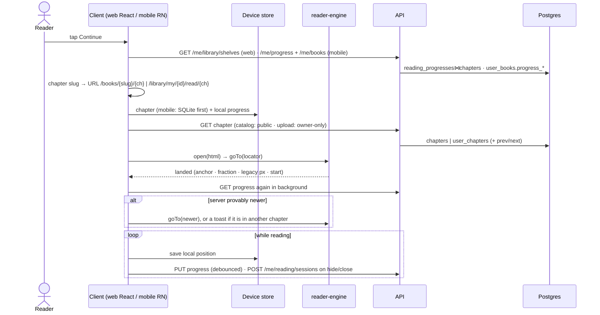

# Open a book and resume reading — current state

**As of 2026-10-28.** Traced for [ADR-027](adr/ADR-027-retire-public-catalog.md) (Proposed, deferred to V2). It describes how the system works today and proposes nothing. The wider map is in [flows.md](flows.md#2-read-a-chapter).

How much to trust each claim:

| Mark | Meaning |
|---|---|
| **[code]** | Read in source during this trace |
| **[inherited]** | Taken from an earlier code survey, with file references, and not reread here |
| **[not run]** | Inferred from code; nothing was executed on a device or against a server |

Nothing in this document was tested at runtime. Every behaviour below is at best **[code]**.

## Sequence

## Steps

### 1. Choose the chapter (client)

The URL is authoritative: once the reader page is open it never moves to a different chapter by itself (`apps/web/src/hooks/useRestoreProgress.ts:136-141`) **[code]**.

- **Web, home "Continue":** the chapter slug comes from `GET /me/library/shelves` (`LibraryShelvesService.cs:43-121`) **[code]**. That reads:
  - `user_books.progress_chapter_slug`, `progress_locator`, `progress_position_json`;
  - for the catalog, the latest `reading_progresses` row joined to `chapters.slug`, `editions` and `edition_authors`.
- **Web, catalog book page "Continue":** reads localStorage `reading.progress.{editionId}` only (`BookDetailPage.tsx:110-120`) **[code]**.
- **Web, upload book page:** asks the server first (`GET /me/books/{id}/progress`), then falls back to localStorage (`UserBookDetailPage.tsx:55-92`) **[inherited]**.
- **Mobile:** `rankContinueReading` (`packages/shared/src/reader/continueReading.ts`) compares AsyncStorage with the server rows using `localProgressWins` (`progressPrecedence.ts:25-39`), which compares the local stamp with the server's *client* stamp **[code]**. The route comes from `apps/mobile/src/lib/bookRoutes.ts` **[inherited]**.

### 2. Load the chapter

| | Catalog | Upload |
|---|---|---|
| Endpoint | `GET /{lang}/books/{slug}/chapters/{ch}`, public (`BooksEndpoints.cs:65-89`) | `GET /me/books/{id}/chapters/{slug}`, owner only (`UserBooksEndpoints.cs:42`) |
| Filter | `Status == Published`, language, site (`BookService.cs:227`) **[code]** | owner + not taken down (`UserBookService.cs:381`) **[code]** |
| Reads | `editions`, `chapters` (html, slug, `chapter_number` for prev/next) | `user_books`, `user_chapters` |
| Web cache | IndexedDB, written after a network load; read only when `editionIdRef` is set, which happens only after a network success (`useReaderChapter.ts:99,126-128,188`) **[code]** | none (`useReaderChapter.ts:208-214`) **[code]** |
| Mobile cache | SQLite `chapters` first, then refresh | SQLite `user_chapters` first, then refresh |

Mobile's device-first order is enforced by `apps/mobile/src/lib/chapterLoadOrder.test.ts` **[code: test exists]**. Its loaders are `useReaderChapter.ts` and `useUserBookReaderSource.ts` **[inherited]**.

### 3. Get the saved position

| | Catalog | Upload |
|---|---|---|
| Route | `GET /me/progress/{editionId}` (`UserDataEndpoints.cs:32`) | `GET /me/books/{id}/progress` (`UserBooksEndpoints.cs:43`) |
| Reads | `reading_progresses`: `chapter_id`→`chapters.slug`, `locator`, `position_json`, `percent`, `client_updated_at` | `user_books.progress_chapter_slug`, `progress_locator`, `progress_position_json`, `progress_percent`, `progress_client_updated_at` |
| No row | 404 | 404 only if both the slug and the locator are null; an original-layout PDF stores `page:N` without a slug (`UserBookService.cs:549`) |

All of the above is **[code]**.

Which position is used:
- **Web, at open:** `preferLocalProgress` (`apps/web/src/lib/progressSync.ts:134`): an unsynced local entry wins, otherwise the server wins. No timestamps are compared **[code]**.
- **Mobile, at open:** device first; the server is checked in the background (`useReaderPersistence.ts`) **[inherited]**.
- **Both, after open:** the reader moves only if `serverProvablyNewer` (`packages/shared/src/reader/newerPosition.ts:18-27`) says the server's client stamp is later. If the newer position is in another chapter, a toast is shown instead of a jump. Web checks at 0/10/30 s, when going online and when the tab becomes visible (`useNewerPositionCheck.ts`); mobile checks on foreground **[inherited for the schedule, code for the rule]**.

### 4. Restore inside the chapter (engine)

1. The client converts `position_json` (a TextPosition: chapter slug, char offset, chapter fraction, quoted anchor) into an engine locator with `positionToLocator` (`packages/reader-engine/src/mappers.ts:84-94`) **[inherited]**.
2. The client calls `engine.goTo`. Web calls it directly; mobile injects it into the WebView **[inherited]**.
3. `resolveLocator` (`packages/reader-engine/src/resolve.ts:14-34`) **[code]** tries, in order: text anchor, chapter fraction, legacy scroll pixels, start of the chapter.
   - A locator for another chapter is refused (ADR-015).
   - A newer `goTo` makes the older one return `superseded` (`engine.ts:459`).

### 5. Writes

**Order of writes**
- **Local first** (localStorage on web, AsyncStorage on mobile), then a debounced PUT.
- **Web** also flushes with a keepalive request on hide and unload.
- **Mobile** writes nothing until the restore has landed (`readerWriteGate.ts`).

All three **[inherited]**.

| | Catalog `PUT /me/progress/{editionId}` | Upload `PUT /me/books/{id}/progress` |
|---|---|---|
| Code | `UserDataEndpoints.cs:117-245` | `UserBookService.cs:572-660` |
| Validates | `chapterId` belongs to the edition | chapter slug exists; `LocatorSpace.MayReplace` (a PDF page never replaces a reflow position, or the reverse) |
| Stale write | `ProgressClock.IsStale` → returns the stored row | `IsStale` → 200, no body |
| Writes | `reading_progresses`: `chapter_id`, `locator`, `position_json`, `percent`, `max_chapter_number` (monotonic), `completed_at` (≥ 0.99), `updated_at`, `client_updated_at` | `user_books.progress_*`, `progress_updated_at`, `progress_client_updated_at`; at ≥ 0.99 `completed_at`, `is_read`, `read_at` |
| Race | a 23505 unique violation is recovered by re-reading the winner | — |

All of the table above is **[code]**. The catalog path has no `LocatorSpace` check on purpose (STATUS, *Deliberately not doing*).

- **Sessions:** `POST /me/reading/sessions` on hide, close or idle, if the session lasted ≥ 10 s and the user is signed in. Requests are queued in `reading.pendingSessions` and written to `reading_sessions` with `edition_id` or `user_book_id` **[inherited]**.
- **Web, catalog only:** the book is added to `user_libraries` at 1 % read (`useReaderLibraryTracking.ts:36-46`) **[inherited]**.
- **PDF uploads in original layout:** positions are `page:N` with no chapter slug. On mobile, Continue maps the page to a chapter through `user_chapters.source_start_page` **[inherited]**.

## Who owns what

| Layer | Owns | Does not own |
|---|---|---|
| **Client** (web React, mobile RN) | the chapter choice (URL or route); the device store; which position wins at open; debounce and queues; the write gate; the toast for a newer position elsewhere | where in the text the position lands |
| **reader-engine** | rendering one chapter; locator → scroll position (the resolve ladder); reporting the current TextPosition | network, storage, which book or chapter |
| **Shared package** | `serverProvablyNewer`, `localProgressWins`, the Continue ranking | — |
| **Backend** | access (public catalog vs owner-only upload, takedown); checking the chapter exists; rejecting stale writes by the client clock (`ProgressClock`, 5 min skew clamp); trusting the progress unit; completion; the catalog's frontier; keeping PDF and reflow positions apart (uploads only); the shelves | the chapter choice, restoring the position |

## Offline and failure

| Case | Behaviour | Basis |
|---|---|---|
| Mobile, offline, chapter downloaded | opens from SQLite at the local position; errors from the refresh and the server check are swallowed | [inherited], [not run] |
| Mobile, offline, not downloaded | offline error, both book kinds | [inherited], [not run] |
| Web, offline, catalog, fresh page load | position from localStorage; the chapter fetch fails and the error screen is shown; the IndexedDB copy is not used | [code], [not run] |
| Web, offline, upload | error screen; there is no cache | [code], [not run] |
| Web, no service worker | the app shell itself does not load offline | STATUS; [not run] |
| Guest, catalog | progress stays on the device (no GET or PUT); web sends it after login (`flushLocalProgress`) | [inherited] |
| Guest, upload on web | "Sign in required" | [inherited] |
| Book or chapter not found | error screen, except an upload PDF in original layout, which opens without a chapter (`ReaderPage.tsx:232`) | [code] |
| Saved anchor text gone | the resolve ladder falls back to fraction, then to the start | [code] |
| Mobile catalog chapter cached without a chapter id | the server PUT is held back until a fresh copy supplies the id | [inherited] |
| Mobile upload with no token | `/me/books/*` presumably fails and is caught; `authFetch` was not read | [not run] |

## Catalog books vs uploads

| | Catalog | Upload |
|---|---|---|
| Book key | `editions.id`, and the slug in the URL | `user_books.id` |
| Content | shared `chapters`, public | per user `user_chapters`, private |
| Position store | `reading_progresses` row (FK `chapter_id`) | columns on `user_books` (chapter slug) |
| Frontier | `max_chapter_number` | none |
| Coordinate-space guard | none (deliberate) | `LocatorSpace.MayReplace` |
| Stale-write answer | the stored row | 200, no body |
| Guest reading | yes, local only | web: no |
| "Yours" | only after saving, or automatically at 1 % on web | always |
| Web offline cache | IndexedDB, written but not read on a fresh page load | none |
| Mobile cache tables | `chapters`, `cached_books` | `user_chapters`, `cached_user_books` |

### Dependencies that exist only because of the public catalog

- A second position store (`reading_progresses`, edition-keyed) next to `user_books.progress_*`, and the `chapters` join to get a slug.
- The public chapter endpoint, with its published, language and site filters.
- The shelves join `reading_progresses` with `editions` and `edition_authors`.
- On mobile: two SQLite table pairs, two AsyncStorage key formats, and `editionIds.ts` to turn a slug into an edition id.
- Web branches on `mode` in `ReaderPage` and about ten hooks. Mobile has `useEditionReaderSource` alongside `useUserBookReaderSource`.
- Guest reading of the catalog, and the web auto-save to the library at 1 %.

These stay as they are without the catalog: the engine, TextPosition, the shared precedence rules, the session queue and `ProgressClock`.

## Defects found (recorded, not fixed)

| # | Defect | Basis |
|---|---|---|
| 1 | **Web catalog books cannot be read offline after a fresh page load.** `editionIdRef` starts as `null`, so the IndexedDB chapter cache is never read before a network success (`useReaderChapter.ts:99,126`). | [code], [not run] |
| 2 | **Web and mobile choose the starting position by different rules.** Web: any unsynced local entry wins, however old (`progressSync.ts:134`). Mobile: compares timestamps (`progressPrecedence.ts:25`). The same account can resume at different places. | [code], [not run] |
| 3 | **Web catalog book page shows "Start" on a new device** despite server progress, because "Continue" reads localStorage only (`BookDetailPage.tsx:110-120`). | [code] |
| 4 | **An upload reflow URL with no chapter shows "Chapter not found"** instead of the saved or first chapter. The error branch is [code] (`ReaderPage.tsx:232`); that a route reaches it is [inherited]. | mixed |
