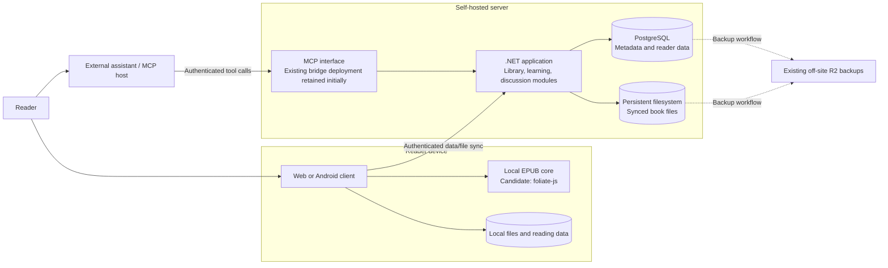

# TextStack V2 architecture — start here

**Status: Discussion · 2026-10-29.** This is the navigation and boundary map for V2, not an accepted
deployment plan. Owner decisions are recorded in the linked target model. Draft SQL has passed
[isolated constraint validation](v2-schema-validation.md), not an application migration.
No new service, runtime or database change is authorized by this document.

## Product and system boundary

Read a personal book locally, understand unfamiliar words without losing the reading flow, and carry
earlier thoughts into later book discussions. Account sync and explicit MCP sharing support that story;
they are not prerequisites for opening a locally retained EPUB.

The following is a target container-level view, not a diagram of everything currently implemented.

Local reading still has an offline path when the server is unavailable. Network-dependent translation
or an external assistant may be unavailable then. Cloud backup is not the application's live file store.
The MCP host sends explicit tool arguments; TextStack does not receive its entire chat automatically.

## Backend modules: start with one application, not new microservices

| Module | Responsibility | Proposed owned records |
|---|---|---|
| Identity/access | Accounts, sessions and MCP authorization | Existing auth tables |
| Library | Owner book identity, file versions and file availability | `books`, `book_files` |
| Reading | Accepted position/frontier and saved quotations | `reading_state`, `annotations`; retained sessions/shelves reviewed separately |
| Learning | Word cards, contexts and review results | `vocabulary_words`, `vocabulary_examples`, `vocabulary_reviews` |
| Discussion | Explicit chapter snapshots and separate saved thoughts | `shared_chapters`, `discussion_checkpoints`; retain legacy insight/review contracts |

Module ownership means a clear write path, not a new process or generic repository framework.
Use existing application/infrastructure boundaries and accepted Dapper conventions. Cross-module
workflows require explicit transactions where relevant, not scattered writes from MCP handlers.

## Authoritative documents

| Question | Read |
|---|---|
| What did the owner decide? | [Target model](v2-target-model.md) |
| Which tables and relationships are proposed? | [Schema overview](v2-schema-overview.md) |
| What does the nine-table DDL actually say? | [SQL draft](v2-library-draft.sql) and [lifecycle notes](v2-library-draft.md) |
| How do discussion saves and retries work? | [Checkpoint PDD](mcp-discussion-checkpoints.md) |
| What exists today? | [Open/resume trace](reader-open-resume.md) and [import gap](epub-import-v2-gap.md) |
| What does the engine experiment need to prove? | [Prototype scope](epub-engine-prototype.md); actual results belong with the prototype implementation |
| What research is deferred? | [ADR-027](adr/ADR-027-retire-public-catalog.md) and [catalog inventory/plan](catalog-retirement-plan.md) |

These documents have different purposes; this page links them rather than duplicating their decisions.
Do not execute the deferred catalog plan as a prerequisite for V2.

## Immediate work and first vertical slice

1. Review this boundary map, the nine-table draft and its [32-check validation](v2-schema-validation.md).
   The disposable PostgreSQL test is complete with a minimal `users` dependency; integration with the
   actual application schema, sync and auth is not. No existing environment was targeted.
2. Prepare a bounded implementation PDD for **Android local EPUB import → open → restart → resume**.
   Base it on the existing prototype and preserve the production reader. Include app-owned file retention,
   clear error/cancellation behavior, resource loading and new position persistence. No account or API required.
3. Keep engine adoption gates explicit: fonts, Android script/resource isolation, a large EPUB and a
   physical device. No production replacement is declared ready from emulator evidence alone.

Full cloud sync is a later slice. Before implementing it, settle upload finalization/retries, concurrent
edits, file deletion, tombstones and stale devices. These unresolved cloud rules do not prevent the
accountless local reading slice. Do not build a generic sync platform before testing that path.

## Open questions

- Nine-table proposal: approve boundaries after disposable PostgreSQL validation?
- Which optional learning/organization/operational features remain in initial V2?
- Who can provide a physical Android for the remaining engine checks?
