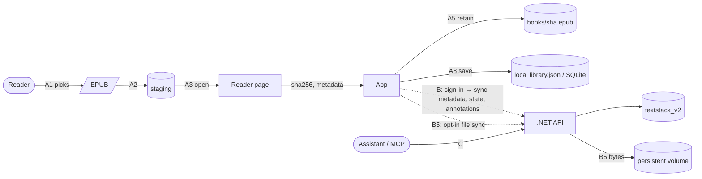
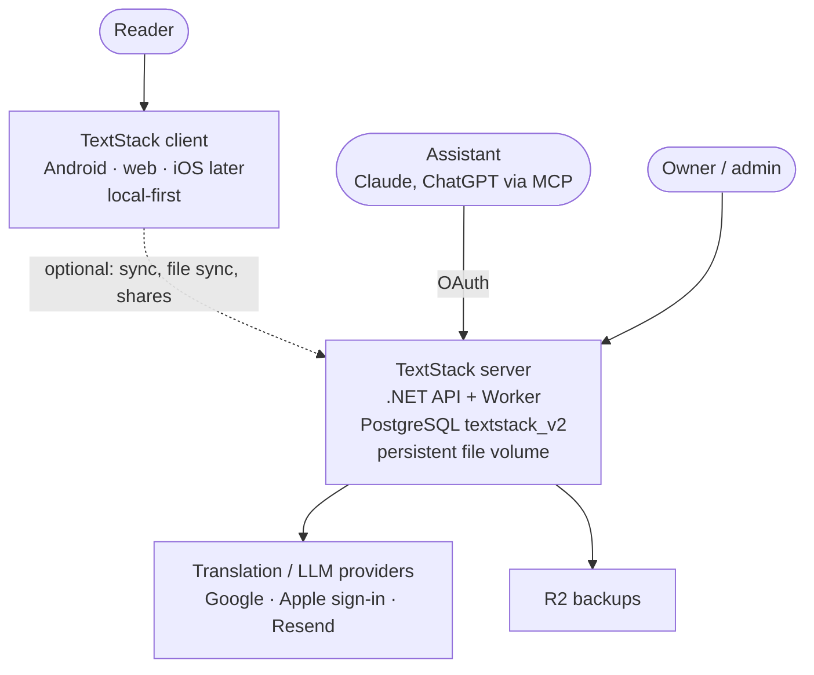
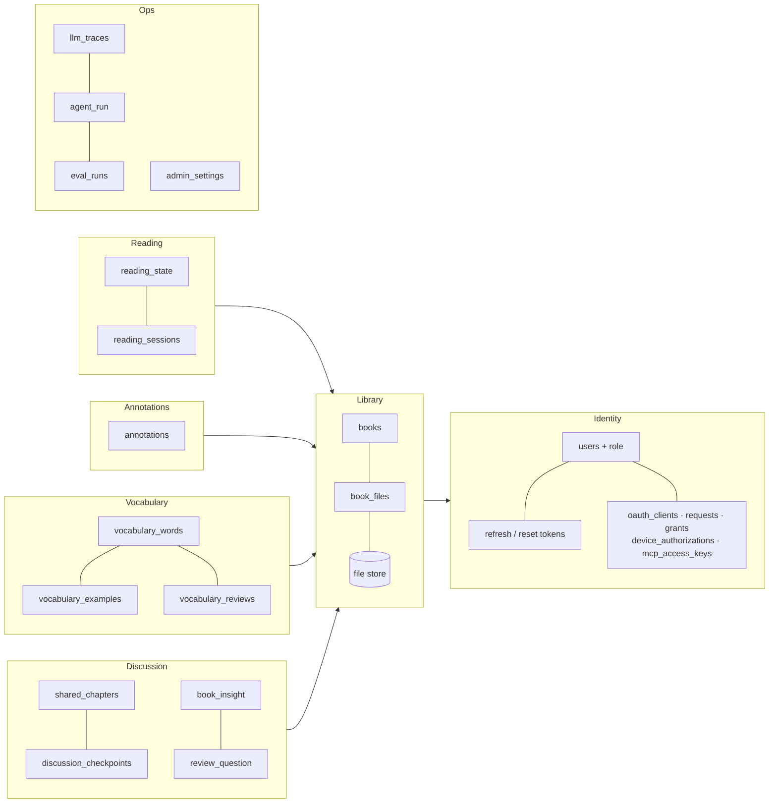
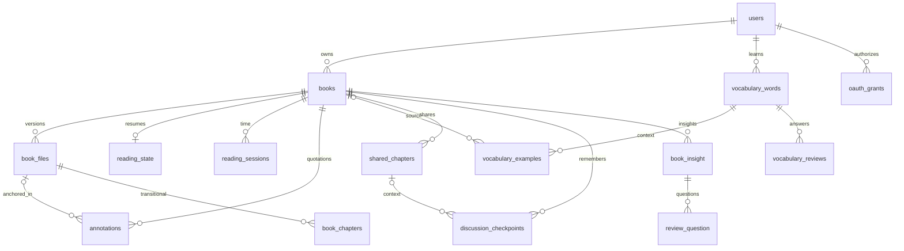
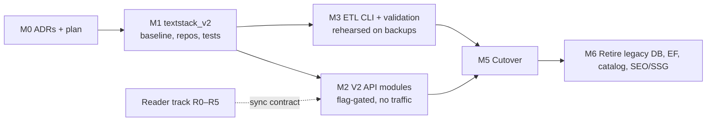

# TextStack V2 — migration strategy and target architecture

> **Status: Proposed · 2026-10-30.** Approved by the owner as the V2 program plan on 2026-10-30. It authorizes no production, schema or deploy change by itself; every slice below ships as its own PR with its own ADR/PDD where marked.
> Audience: the owner (this is the golden path to study) and the agent sessions that execute one slice each.

**Start here:** [v2-architecture.md](v2-architecture.md) → this plan → the slice you own.
**Owner decisions:** [v2-target-model.md](v2-target-model.md) plus the 2026-10-29 answers recorded in §1.3.
**Bound by:** ADR-026 (SQL-first migrations) · ADR-028 (Dapper + repositories; **port in progress, pilot = `book_insight` only**) · ADR-025 (reader engine; amended by R0) · ADR-027 + [catalog-retirement-plan.md](catalog-retirement-plan.md) (research input, reused in §5) · [epub-engine-prototype.md](epub-engine-prototype.md) · [mcp-discussion-checkpoints.md](mcp-discussion-checkpoints.md).

---

## 1. Why, and what was decided

### 1.1 Problem
TextStack is a public SEO library that grew a personal reader. Today: 58 tables, two parallel reading models (catalog `editions` vs uploads `user_books`), 56 EF `DbSet`s in ~115 files, a frozen catalog, a Dapper pilot on one table, and a foliate-js prototype that reads EPUBs offline on an emulator. The owner wants a **personal, local-first reader** (translation, vocabulary, MCP book discussions) with an architecture one person can read end to end.

### 1.2 Outcome
- One clean PostgreSQL database `textstack_v2` (~24 tables), SQL-first, Dapper-only, every table with one owner module and one lifecycle.
- One .NET process; modules = aggregates; no EF Core.
- Reading needs no account: the client owns the file and the reading data; the server holds metadata, synced state and explicit MCP shares.
- Legacy database, EF Core, public catalog, SEO/SSG and the server-chapter reader are retired as whole units, after an archived and rehearsed cutover.

### 1.3 Decisions taken 2026-10-29 (owner)
| # | Decision |
|---|---|
| D1 | One plan, two tracks: **DB track** and **reader track**; they meet at book identity + locator format. Reader never waits for the DB. |
| D2 | New V2 schema **in a separate database** `textstack_v2`, not in `public` next to legacy. ETL copies preserved data; legacy DB is archived then dropped whole. |
| D3 | Public catalog is retired **within V2** (archive → ETL of user-touched books → drop with the legacy DB). |
| D4 | **Full EF → Dapper**: V2 DB is Dapper from day one; EF Core leaves with the legacy DB. |
| D5 | Catalog books a user touched become **active V2 `books` rows with no file** ("import the EPUB to read"); legacy positions reset. |
| D6 | Of the optional features, **only vocabulary words survive** (words + examples + reviews). Bookmarks, goals, achievements, clusters, tutor, lookups, pending words, vocabulary settings are retired. |
| D7 | `admin_users`/`admin_refresh_tokens` → `users.role`; `models`/`model_promotions` → configuration; `eval_runs`, `llm_traces`, `agent_run` stay. |
| Earlier | Android + web first; server filesystem for synced files; ~20 tables is a guide; checkpoints per book; removal keeps hidden provenance; replacement keeps identity; legacy highlights may stay unanchored; no legacy→CFI conversion required. |

**Why a second database (D2) is the right call here.** Three V2 names (`book_files`, `vocabulary_words`, `vocabulary_reviews`) collide with live legacy tables. A rename adds `legacy_*` noise to the schema the owner will read for years; a Postgres-schema split complicates `migrate.sh`, the drift tests and backups. A second database gives a **baseline `0000` that is the final schema**, a migration ledger that starts clean, and a legacy DB that dies as one unit. The price: cross-DB foreign keys are impossible, so `users` must live in V2 from cutover, and the cutover is one rehearsed event rather than table-by-table drift. §5 handles that.

---

## 2. Domain stories

Actors: **Reader**, **App** (Android / web), **Reader page** (foliate inside WebView/browser), **Server** (.NET + `textstack_v2`), **Assistant** (MCP client). Work objects in *italics*.

### Story A — Read my own EPUB offline (no account)
1. Reader picks an *EPUB*. 2. App copies it to *staging*. 3. Reader page opens it, returns *title/author* and *sha256*. 4. Same *sha256+size* already in the *local library* → open the existing *book*. 5. Else move to *retained books/*, add a *book entry*. 6. Reading produces a *position* (CFI + 64-char quote). 7. Selecting text produces a *highlight* (CFI, quote, prefix/suffix). 8. App saves both into the local *book entry*. 9. Kill → relaunch → App restores the *position* only if the quote still matches. 10. Deleting the original in Downloads changes nothing.

### Story B — Sign in; progress, words and notes follow me
1. Reader signs in. 2. App creates the server *book* (client UUID, title, author) and the *file version* (sha256, size, name; **no bytes**). 3. App pushes *reading state* (locator envelope, fraction, frontier, revision) and *annotations*; server accepts with `revision` optimistic concurrency and `operation_id` idempotency. 4. On a second device the *book* appears as "not imported here"; importing the same bytes attaches the existing *file version* and the *reading state* applies. 5. Reader enables **file sync** for that book → App uploads bytes → server stores them under the *storage key*; Reader can now fetch the file on another device.

### Story C — Discuss a chapter with the Assistant
1. Reader explicitly **shares** chapter N: App sends *chapter text + selected notes* → `shared_chapters` snapshot (immutable; re-share = new snapshot). 2. Assistant calls `get_my_insights`/checkpoints for that *book*, reads the *shared chapter*, never other chapters. 3. Reader opts in once per book (`checkpoint_saving_enabled`). 4. After a meaningful topic the Assistant saves a *checkpoint* (topic, reader thoughts, assistant suggestions, conclusions, open questions, `operation_id`). Retry returns the same entry; changed payload under the same id conflicts. 5. Words the Reader asked about are offered once; on yes → *vocabulary word* (one card per owner/language/word_key) + *example* (sentence, contextual translation). 6. Removing the book hides it (`removed_at`); shares and checkpoints remain readable and separately deletable.

### Story D — A legacy reader returns after cutover
1. Their *uploads* are V2 *books* with the same ids, current *file version* (sha256 kept), *reading state* carried as a `textstack-position-v1` locator, *highlights* as anchored *annotations* on that file. 2. Their *catalog books* they saved/highlighted/learned from are V2 *books* with **no file**: visible, with *annotations* (unanchored quotations) and *vocabulary examples* with `book_title`; the card says "import the EPUB to read". 3. Their words keep translation, SRS stage, interval, next review and every *review*. 4. Their *insights* and *review questions* are intact. 5. Their old app build still works for a bounded window through a compatibility shim; then it is asked to update.



---

## 3. Target architecture (C4)

Mermaid flowcharts, same convention as [c4-worker-scaling.md](c4-worker-scaling.md).

### L1 — System context


### L2 — Containers during transition (M1–M5) and after (M6)
```mermaid
flowchart TB
  subgraph Device
    ui[App UI]
    v2r[V2 reader page<br/>foliate, CFI]
    oldr[Legacy reader<br/>server chapters, PDF]
    loc[(local files + reading data)]
    ui --> v2r --> loc
    ui --> oldr
  end
  subgraph Server["one .NET process (Api) + Worker"]
    v2[V2 modules<br/>Dapper repositories]
    leg[Legacy modules<br/>EF Core]
    shim[Compatibility shim<br/>old routes → V2]
  end
  db2[(textstack_v2<br/>~24 tables)]
  db1[(textstack legacy<br/>58 tables, read-only after cutover)]
  fs[(files volume<br/>library/{user}/{book}/{file})]
  ui --> v2 --> db2
  v2 --> fs
  oldr --> leg --> db1
  shim --> v2
  etl[ETL CLI<br/>migrate-v2] --> db1
  etl --> db2
  classDef gone stroke-dasharray: 5 5
  class leg,db1,oldr,etl gone
```
Dashed = removed at M6. After M6: App → V2 modules → `textstack_v2` + files volume. Nothing else.

### L3 — Server modules (one module = one aggregate family = one repository set)

Dependency rule: `Api → Application → Domain ← Infrastructure` (unchanged). Each module: `Application/<Module>/` (service + `I<Aggregate>Repository` port), `Infrastructure/Persistence/Repositories/<Aggregate>Repository.cs` (Dapper, SQL beside the method), `Api/Endpoints/<Module>Endpoints.cs`, `tests/TextStack.Persistence.Tests/<Module>/`.

---

## 4. Target data model — `textstack_v2`

### 4.1 Principles (the schema's house rules, go into `database/v2/README.md`)
1. **One table, one owner module, one lifecycle** — table comment says which.
2. **Ownership in the key**: every user-owned table carries `user_id`; composite FKs `(user_id, …)` so a row can never point at another user's row; every query also filters `user_id` (ADR-028 §5).
3. **Client-generated UUIDs** for offline creation; server never renumbers.
4. **Soft removal only where the product needs it** (`books.removed_at`, `annotations.deleted_at`, `vocabulary_words.deleted_at`); everything else hard-deletes.
5. **Idempotency keys** on every client-replayable write: `operation_id` unique per user; `revision` for last-writer protection.
6. **Locators are envelopes** `{"version":1,"scheme":"epub-cfi"|"pdf-page"|"textstack-position-v1"|"textstack-anchor-v1","value":…}`; `epub-cfi` also carries `quote` (first ≤64 chars at the CFI; required for resume positions, optional on annotations — ADR-031); DB checks the shape, the application validates the content.
7. **Enums as text** with CHECK; **timestamps `timestamptz`**; `created_at`/`updated_at` set by the repository, no triggers.
8. **No JSON for things we query by**; JSON only for opaque client payloads (locators, checkpoint sections).
9. **Account deletion = `users` CASCADE**; provenance FKs are `DEFERRABLE INITIALLY DEFERRED` (validated in [v2-schema-validation.md](v2-schema-validation.md)).
10. `database/v2/migrations/0000_baseline.up.sql` **is** the schema and is readable top to bottom, grouped by module, each table preceded by a 1–3 line comment. `docs/01-architecture/data-model.md` gets a V2 section mirroring it.

### 4.2 Tables (24) and their origin
| Module | Table | One row is | From legacy | Notes vs draft SQL |
|---|---|---|---|---|
| Identity | `users` | an account (reader, guest, or staff) | `users` (357) + `admin_users` (1) | add `role text CHECK (role IN ('reader','admin'))`; guests stay (ADR-014) |
| | `user_refresh_tokens` | a session | `user_refresh_tokens` + `admin_refresh_tokens` | one shape |
| | `password_reset_tokens` | a reset code | same | |
| | `oauth_clients`, `oauth_authorization_requests`, `oauth_grants`, `device_authorizations`, `mcp_access_keys` | MCP auth | same | `oauth_authorization_requests.user_id` gets a real FK |
| Library | `books` | a library entry | `user_books` (96, same id) + catalog pairs (D5, deterministic id) | **add** `origin jsonb` (`{"kind":"upload"}` / `{"kind":"catalog","editionSlug":…}` / `{"kind":"clip","sourceUrl":…}`), `cover_key text`, `tags text[] NOT NULL DEFAULT '{}'`, `description`, `genre`, `published_year` (from `user_books`); `checkpoint_saving_enabled` per draft |
| | `book_files` | an exact file version | `user_book_files` (96, same id, sha256 kept) | **CHECK `format IN ('epub','pdf','html')`** (draft said epub only; 22+ PDFs exist; `html` = clips); `page_count int`, `toc jsonb` (nullable, from `user_books`); `server_storage_key` = relative path on the volume |
| Reading | `reading_state` | accepted state for one book | `user_books.progress_*` → scheme `textstack-position-v1` (reflow `progress_position_json`) or `pdf-page` (PDF `page:<n>`); catalog `reading_progresses` **not migrated** (owner exception) | per draft |
| | `reading_sessions` | a reading interval | `reading_sessions` (587) | `book_id` nullable (deleted-book trail kept); unique `(user_id, client_session_id)` |
| Annotations | `annotations` | a highlight + note, or an unanchored quotation | `highlights` (39): `selected_text`, `note_text`, color; uploads → `file_id` + locator `textstack-anchor-v1` (prefix/exact/suffix) or `pdf-page` (PDF highlights: page + rects); catalog → unanchored | per draft |
| Vocabulary | `vocabulary_words` | one card per owner/language/word_key | `vocabulary_words` (1,824): word, translation, definition, SRS stage/interval/next_review | drop `embedding`, cluster/tutor fields (D6) |
| | `vocabulary_examples` | a source sentence for a card | legacy context sentence + `book_title` snapshot + mapped `book_id` | `operation_id` = generated per migrated row |
| | `vocabulary_reviews` | one answer | `vocabulary_reviews` (461) | |
| Discussion | `shared_chapters` | an explicit chapter snapshot for MCP | — (new) | |
| | `discussion_checkpoints` | one saved stage of a discussion | — (new) | |
| | `book_insight` | existing insight / chapter review | `book_insight` (7) | `edition_id`/`user_book_id` → one `book_id` |
| | `review_question` | self-check question | `review_question` (11) | |
| Ops | `llm_traces`, `agent_run`, `eval_runs`, `admin_settings` | diagnostics, settings | same | `agent_run.edition_id` dropped |
| **Transitional** | `book_chapters` | server-extracted chapter of a file version (`file_id`, `chapter_key`, title, html, plain_text) | `user_chapters` (2,710) | **Exists only until the V2 reader serves EPUB and PDF on all clients**; feeds the legacy reader, `get_my_chapter` and `shared_chapters` snapshots. Table comment states the sunset. |
| | `ingestion_jobs` | server extraction job for an uploaded file | `user_ingestion_jobs` | same sunset |

Retired with the legacy DB (no V2 table; full per-table disposition in [ADR-031](adr/ADR-031-v2-schema.md)): the 19 live tables of the catalog section (incl. `sites`, `site_domains`, `book_quality_jobs`), `user_libraries` (its rows become `books` rows), `reading_progresses`, `bookmarks`, `user_book_bookmarks`, `reading_goals`, `user_achievements`, `pending_vocabulary_words`, `word_lookups`, `user_vocabulary_settings`, `word_clusters`, `tutor_session`, `models`, `model_promotions`, `collections`, `book_collections` (recommendation Q3: retire; `user_books.tags` is carried as `books.tags text[]`, ADR-031 decided item 3), `admin_users`, `admin_refresh_tokens` (both fold into Identity tables).

Deployment of the database itself (recommendation Q1): `textstack_v2` is a second database **in the existing `db` container**, created by a `migrator-v2` compose service; one volume, one backup job, one pool of RAM.

### 4.3 ERD


### 4.4 Lifecycle contracts (expressed in SQL + repository tests)
- One current `book_files` row per book (partial unique). Replacement: insert new version, flip `is_current` in one transaction, old bytes deleted by a separate retried job; old row stays for provenance.
- `reading_state` frontier never decreases on normal writes; explicit reset is a named repository method. Stale `revision` → 409.
- Book removal: `removed_at` only. Account deletion: `users` cascade; `SET CONSTRAINTS ALL IMMEDIATE` at the end of the transaction in tests.
- Vocabulary: `UNIQUE (user_id, language, word_key)` includes tombstones; re-save adds an example, never resets SRS; explicit update changes translation.
- Checkpoints: `UNIQUE (user_id, operation_id)`; same payload → same row; different payload → 409.
- Shares: immutable; delete clears `discussion_checkpoints.shared_chapter_id` then deletes, one transaction.

### 4.5 File store
`library/{userId[..2]}/{userId}/{bookId}/{fileId}.{epub|pdf}` on the persistent volume (`Storage:LibraryRoot`). Covers: `…/{bookId}/cover.{ext}`. R2 backup includes the root. Retention: current version's bytes only after a successful replacement.

---

## 5. Migration strategy (DB track)

### 5.1 Shape

- **Strangler by database, not by table.** New code only ever talks to `textstack_v2`. Legacy code is untouched until deleted. No table is "half EF, half Dapper" (ADR-028 §3 holds trivially).
- **Both DBs in one process** during M2–M5: a second `NpgsqlDataSource` (`V2DataSource`) registered beside the existing one; `IAppDbContext` stays bound to legacy.
- **Cutover is one rehearsed event**, not a drift: the ETL is run on restored backups until the validation script reports 0 failures three times in a row; then on production inside a write freeze (minutes, not hours — the data is small: 58 tables, largest preserved set is `user_chapters` 131 MB).

### 5.2 ETL — `dotnet run --project backend/src/Api -- migrate-v2 [--dry-run] [--source <cs>] [--target <cs>]`
- Reads legacy with Dapper (read-only connection), writes V2 through the **same repositories the API uses** (so every constraint and ownership rule is exercised) except bulk `book_chapters`, which uses `COPY`.
- **Deterministic ids**: uploads keep ids; catalog pairs → `uuid_v5('textstack-v2', user ‖ edition)`; examples/reviews `operation_id` = `uuid_v5(…, legacy row id)`. Re-runs are no-ops (`ON CONFLICT DO NOTHING` + count report).
- **Pair selection** for catalog books = the intent query from [catalog-retirement-plan.md §3.4](catalog-retirement-plan.md) minus bookmarks (retired).
- Ledger `migration_runs(id, started_at, finished_at, source_dump_sha, counts jsonb, validation jsonb)` in V2 — the only table not in §4.2; dropped at M6.
- **Validation script** `database/v2/scripts/validate-etl.sql` (adapted from catalog plan §6.2): completeness per intent pair; ownership; every migrated annotation's `selected_text` found in its chapter `plain_text` (uploads); SRS fields equal; review counts equal; insight hashes equal; sessions seconds per user equal; 0 rows with unknown `user_id`.
- Rehearsal = `restore-drill.yml` + `migrate-v2` + validation on a throwaway branch (the drill already restores a backup).

### 5.3 Cutover (M5), step list
1. Deploy build N: V2 modules on, flag `Database:Mode=legacy`. Shim (§5.4) deployed but dormant.
2. Announce window; `MOBILE_MIN_SUPPORTED_BUILD` unchanged.
3. Freeze: API returns 503 on writes to legacy for ≤10 min (`Maintenance:WriteFreeze=true`).
4. `pg_dump` legacy → archive (outside restic retention); git tag `pre-v2-cutover`.
5. `migrate-v2` on production; `validate-etl.sql` → must be 0 failures.
6. Flip `Database:Mode=v2` (force-recreate api/worker). Legacy DB `ALTER DATABASE … SET default_transaction_read_only = on`.
7. Smoke: web + Android: sign in, library, open upload, highlights, vocabulary, MCP S1–S10 scenario suite (reused from catalog plan §8.1).
8. **Rollback** (within the window): flip back to `legacy`, read-only off. Legacy was never written by V2 code, so nothing to reconcile.

### 5.4 Old clients and old routes
Old mobile builds send edition-keyed and `user_books`-keyed calls. Catalog plan §7's write matrix applies, simplified: upload ids are unchanged (`books.id = user_books.id`), so most old upload routes map 1:1; edition-keyed writes → the V2 `books` row for that pair (or 410 if none); catalog reads → 410 "catalog retired". Shim logs `X-App-Version` + route + outcome. Window (recommendation Q4): **60 days, closed only when the log has been silent for the last 14**; iOS is treated as in production until the owner says otherwise, so the log, not the calendar, ends the shim.

### 5.5 Retire (M6)
Pure deletions, one PR each, after the shim window: catalog/SEO/SSG backend + crews + `TextStack.Search` + SSG scripts + nginx/deploy steps (catalog plan §2.5 inventory), `AppDbContext` + EF packages + `SchemaDriftTests`, legacy `database/migrations/` (kept in git history; `database/v2/` becomes `database/`), web/admin/mobile catalog UI, `DROP DATABASE textstack` after the archive is verified restorable.

---

## 6. Data access (Dapper) — module → repository map
| Module | Repository ports (Application) | Notes |
|---|---|---|
| Identity | `IUserRepository`, `ISessionTokenRepository`, `IOAuthRepository`, `IMcpKeyRepository` | AuthService re-implemented over V2; guest merge rewritten per aggregate (§6.1) |
| Library | `ILibraryRepository` (books + files), `IFileStore` (volume) | import/replace/remove/restore |
| Reading | `IReadingStateRepository`, `IReadingSessionRepository` | `AdvanceAsync(userId, bookId, state, expectedRevision)` |
| Annotations | `IAnnotationRepository` | |
| Vocabulary | `IVocabularyRepository` (words+examples+reviews, one aggregate) | `SaveWordAsync` upsert-by-key + `AddExampleAsync` |
| Discussion | `ISharedChapterRepository`, `ICheckpointRepository`, `IInsightRepository` (**exists**, re-pointed to `book_id` + V2 data source), `IReviewQuestionRepository` | |
| Ops | `ILlmTraceWriter`, `IAgentRunWriter`, `IEvalRunRepository`, `IAdminSettingsRepository` | |
| Transitional | `IBookChapterRepository`, `IIngestionJobRepository` | deleted with the table |

Rules: [data-access.md](data-access.md) 1–9 unchanged. Transactions: a V2 unit of work is `await using var tx = await v2.BeginAsync(ct)` passed explicitly (the ADR-028 §4 parameter, now typed `NpgsqlTransaction`, since EF is absent on this side). Tests: `tests/TextStack.Persistence.Tests` gets a second fixture `V2PostgresFixture` (Testcontainers + `database/v2/migrate.sh up`); every repository ships an **owner-isolation test** (alice/bob pattern from `InsightRepositoryTests`).

### 6.1 Guest → account merge (V2)
Per aggregate, in one transaction: books — reparent; same `sha256` on both sides → keep the account's book, move the guest's annotations/sessions/examples onto it; reading_state — higher `revision`/newer `client_recorded_at` wins, frontier = max; vocabulary — same `word_key` → keep account card, move examples/reviews; insights/checkpoints/shares — reparent (today's merge drops insights: fixed deliberately).

---

## 7. Reader track (unchanged in substance from the 2026-10-29 reader plan)

Verified from prototype code (not from its README): retained copy + immediate open + sha256 dedupe (`foliate.tsx:98-159`, `library.mjs:21`); CFI+quote resume and highlights (`page.mjs:195-294`); malformed/interrupted/missing-file handling; CSP sandbox (`build.mjs:55`); pin `78914aef` + one-line paginator patch + reproducer; serialized navigation; `file://` direct read. **README-only**: kill/relaunch results, 4.7 s vs 27.9 s timing, hostile-book results (gate script asserts nothing), physical device. **Defects to fix when porting**: non-atomic `writeStore`; mount effect runs before the `__DEV__` redirect; `file://` + `connect-src file:` exposure needs a review; a fresh clone does not build (generated page gitignored). **Doc conflict**: ADR-025 (Accepted) rejects foliate → R0.

| Slice | Agent | Do | DoD |
|---|---|---|---|
| **R0** [ADR-029](adr/ADR-029-foliate-for-v2-epub.md) foliate for V2 EPUB | architect → tech-writer | iframe/paginated/`epub-cfi`; ADR-025 stays for PDF + transitional server chapters; pin/patch/licence policy; gates | merged, no code |
| **R1** page core + build | mobile-engineer | port `page.mjs`/`store.mjs`/`library.mjs`/patch to `apps/mobile/src/lib/v2reader/`; committed `v2ReaderPage.generated.ts` + CI drift check (pattern: `apps/web/scripts/mobile-bundles.mjs`) | typecheck+vitest green; fresh clone builds |
| **R2** Android dev route | mobile-engineer | `app/dev/epub-v2.tsx` (`__DEV__ ? require : Redirect`), `V2ReaderScreen`, storage `<documents>/v2/`, tmp-write for all state | release bundle has no page; emulator import→kill→resume evidence |
| **R3** sandbox + asserting checks | qa-automation | hostile vectors (SVG script, `<base>`, `<embed>`, `srcdoc`, meta refresh, `file://` sibling), Playwright check exits non-zero | fails when a CSP directive is removed |
| **R4** adoption gates | qa + owner | physical device, 80 MB book, real ENOSPC, old WebView, security review | evidence table in `epub-engine-prototype.md`; ADR-029 updated |
| **R5** web dev path | frontend-engineer | dev-only route or reader-engine playground; ArrayBuffer in; localStorage only | prod bundle unchanged |
| **R6** local library + sync client | mobile-engineer | SQLite (new DB name) for books/state/annotations; sync to M2 API with `revision`/`operation_id`; file sync opt-in | offline first; conflict tests |
| **R7** PDF on the V2 path | mobile-engineer | existing pdf.js viewer behind V2 `books`/`book_files`, locator scheme `pdf-page` | PDF uploads readable on V2 |
| **R8** retire legacy reader | mobile/frontend | delete `ReaderShell` server-chapter path; drop `book_chapters` + `ingestion_jobs` (M6 gate) | |

---

## 8. Slices by milestone (one agent session each)

Fixed rules for every slice: English only; one PR, closes its issue; `/pr` writes the CHANGELOG line + archive write-up; never deploy by SSH; never cite external apps/courses; no new npm/native dependency without the slice saying so; the server **typography fix** from the prototype clone is its own slice **T** (backend-engineer), never bundled.

### M0 — Decisions on record (docs only)
| # | Agent | Deliverable |
|---|---|---|
| M0.1 | tech-writer | this plan → `docs/01-architecture/v2-plan.md`; `STATUS.md` V2 section; fix stale date — **done 2026-10-30** |
| M0.2 | architect | **[ADR-030 Two databases, one cutover](adr/ADR-030-two-databases-one-cutover.md)** (D2, §5) — supersedes the in-place parts of ADR-027 |
| M0.3 | architect | **[ADR-031 V2 schema](adr/ADR-031-v2-schema.md)** (§4; disposition of all 58 tables; D5–D7); `data-model.md` V2 section |
| M0.4 | architect | **[ADR-029 foliate-js renders V2 EPUBs](adr/ADR-029-foliate-for-v2-epub.md)** (reader, R0) |
| M0.5 | product-manager | GitHub issues for every slice, labels `v2-db`, `v2-reader`, `v2-cutover` |

### M1 — `textstack_v2` exists and is tested
| # | Agent | Do | DoD |
|---|---|---|---|
| M1.1 | backend-engineer | `database/v2/migrations/0000_baseline.up.sql` (§4.2, from the validated draft + deltas), `database/v2/migrate.sh` (copy of today's, `PGDATABASE=textstack_v2`), `roundtrip.sh` wired; compose service `migrator-v2`; `.env` `V2_DB_*` | roundtrip green; 32 draft checks re-run green; README of the schema |
| M1.2 | backend-engineer | `V2DataSource` + `V2PostgresFixture`; `ILibraryRepository` + `IReadingStateRepository` + tests | owner-isolation tests; revision conflict test |
| M1.3 | backend-engineer | `IAnnotationRepository`, `IVocabularyRepository` + tests | re-save adds example, keeps SRS |
| M1.4 | backend-engineer | `ISharedChapterRepository`, `ICheckpointRepository`, re-point `IInsightRepository`, `IReviewQuestionRepository` + tests | retry/conflict/share-delete tests |
| M1.5 | backend-engineer | Identity repositories + `users.role`; ops repositories; transitional `IBookChapterRepository` | account-delete cascade test with `SET CONSTRAINTS ALL IMMEDIATE` |

### M2 — V2 API, no traffic
| # | Agent | Do | DoD |
|---|---|---|---|
| M2.1 | architect → backend | **Sync PDD**: payloads, `revision`, `operation_id`, conflict codes, file-sync upload protocol | PDD merged |
| M2.2 | backend-engineer | Library + Reading + Annotations endpoints under `/me/v2/*` (temporary prefix, renamed at M5), behind `Features:V2Api` | integration tests (new `LiveApiFixture` mode) |
| M2.3 | backend-engineer | Vocabulary endpoints + MCP vocabulary tools re-pointed (manifest + 4 count tests together) | MCP tests |
| M2.4 | backend-engineer | Shares + checkpoints endpoints + MCP tools (`share_chapter`, `list_checkpoints`, `save_checkpoint`) | PDD tests from `mcp-discussion-checkpoints.md` |
| M2.5 | backend-engineer | Auth over V2 (`AuthService` rewrite, merge §6.1, account delete), admin role | auth integration tests |
| M2.6 | backend-engineer | File store + upload/replace/remove; transitional extraction worker writing `book_chapters` | Worker tests |
| M2.7 | frontend/mobile | clients speak V2 behind the same flag (library, reader-open, highlights, vocabulary) | e2e on flag |

### M3 — ETL rehearsed
| # | Agent | Do | DoD |
|---|---|---|---|
| M3.1 | backend-engineer | `migrate-v2` CLI skeleton, ledger, dry-run, counts | runs on CI Testcontainers pair |
| M3.2 | backend-engineer | mappers: users/admin → users; uploads → books/files/state/annotations/chapters | validation §5.2 parts 1–4 |
| M3.3 | backend-engineer | catalog pairs → books (no file) + unanchored annotations; vocabulary → words/examples/reviews; insights, sessions | validation parts 5–8 |
| M3.4 | qa-automation | `validate-etl.sql`; T1–T4 from catalog plan §6.1 (interrupted, retry, concurrent, idempotent) | all green on a fixture DB |
| M3.5 | owner + backend | 3× rehearsal via `restore-drill.yml` on real backups; report on the issue | 0 failures ×3 |

### M4 — Reader track R0–R7 (parallel, see §7)

### M5 — Cutover
| # | Agent | Do |
|---|---|---|
| M5.1 | backend-engineer | shim §5.4 + `Database:Mode` flag + write-freeze switch; MCP alias stage |
| M5.2 | qa-automation | cutover runbook `docs/03-ops/v2-cutover.md`; MCP S1–S10 suite; smoke checklist |
| M5.3 | owner | execute §5.3; incident template open during the window |
| M5.4 | backend | rename `/me/v2/*` → final routes; `routes.public.txt` |

### M6 — Retire
M6.1 catalog/SEO/SSG code · M6.2 EF Core + `AppDbContext` + drift tests · M6.3 legacy clients UI · M6.4 `book_chapters`/`ingestion_jobs` (after R8) · M6.5 `DROP DATABASE` after the archive restore is proven · M6.6 docs: `data-model.md` = V2 only, `CLAUDE.md` commands updated.

---

## 9. Risks and how the plan holds them
| Risk | Mitigation |
|---|---|
| `users` must exist in V2 before any V2 write | M2.5 auth over V2 ships before any flag is enabled for real users; until M5 V2 is test-only |
| Cutover is a single event | ≤10 min freeze, small data, 3 rehearsals, rollback = flip flag (legacy never written by V2) |
| Old mobile builds (iOS cannot be forced) | shim §5.4 with logging; window decided in Q4 |
| Transitional `book_chapters` becomes permanent | table comment + ADR-031 sunset + M6.4 gate on R8 |
| ETL silently drops data | validation script is the gate; owner exceptions (catalog positions, bookmarks, goals, clusters) are **listed in ADR-031**, not implicit |
| foliate `file://` exposure | R3 + R4 security review before any non-dev route |
| EF removal stalls | nothing new is ever added to EF; EF dies with the DB, not table by table |

## 10. Verification (end to end)
- `database/v2/tests/roundtrip.sh` + `dotnet test tests/TextStack.Persistence.Tests` (both fixtures) in CI.
- `migrate-v2 --dry-run` + `validate-etl.sql` in CI against a seeded legacy fixture.
- `restore-drill.yml` variant: restore → ETL → validate → 0 failures.
- Integration tests on `Database:Mode=v2`; MCP over-the-wire S1–S10.
- Reader: R3 Playwright check; R4 evidence table.
- After M6: `git grep -l "DbContext\|EntityFrameworkCore" backend/` returns nothing; `\dt` on `textstack_v2` lists the 24 tables of §4.2 and nothing else.

## 11. Session handoff template
> Slice **Mx.y / Rn** of `docs/01-architecture/v2-plan.md`. Read §1.3, §4 (if DB), §6 rules, and your row in §8. Read only the files it names. Branch `v2/<slice>-<name>`. Do not touch legacy modules unless the slice says so. Stop and report if the DoD needs anything outside the slice.

---

## Bug Report (found while planning; not fixed here)
- Draft `book_files.format CHECK (format = 'epub')` would reject the 22+ existing PDF uploads.
- Draft `books` has no provenance/cover columns though the owner requires hidden provenance after removal.
- Today's guest merge (`AuthService.MergeGuestCoreAsync`) does not reparent `book_insight`, `review_question`, `oauth_grants` — they vanish with the guest row.
- `oauth_authorization_requests.user_id` has no FK; survives account deletion.
- Prototype: non-atomic `writeStore` (`foliate.tsx:24`); effect before `__DEV__` redirect (`:66`); README contradicts itself on the patch (`:321`); check scripts always exit 0.
- `STATUS.md:3` stale date.

## Open questions — with my recommendation (the plan uses these as defaults until overruled)

| # | Question | Recommendation | Why |
|---|---|---|---|
| 1 | Second DB: same Postgres instance or a second container? | **Same instance, second database** (`CREATE DATABASE textstack_v2` in the existing `db` container; `migrator-v2` service points at it) | One backup job, one volume, one pool of RAM on a 30 GiB home server; `pg_dump` of either DB is unchanged; the ETL runs over two connections on localhost. A second container buys isolation nobody needs and doubles the ops surface. |
| 2 | Transitional `book_chapters`: accept, or make cutover wait for the V2 reader (R7/R8)? | **Accept it, with the sunset written into ADR-031 and the table comment** | The DB track is the owner's priority; without it the cutover waits for foliate on web + Android + PDF, which is months and device-gated (R4). The table is a straight copy of `user_chapters` keyed by `file_id`, so it costs one repository and one worker and is deleted by M6.4. A clean schema that ships beats a cleaner one that waits. |
| 3 | `collections` / `book_collections` (1 shelf, 3 rows) | **Retire** | 3 rows of real usage, two tables, a polymorphic `book_id` that already broke once. If shelves return, a `books.tags text[]` column covers it with no join table. Consistent with D6 ("only words survive"). |
| 4 | Old-client shim window; iOS in production? | **60 days**, measured by the shim log being silent for the last 14 of them; **iOS treated as in production** until the owner confirms otherwise | 30 days is shorter than one slow upgrade cycle on Android; 90 keeps legacy routes alive past the point where anyone looks at them. Android ≥ #743 can be forced via `MOBILE_MIN_SUPPORTED_BUILD`; iOS cannot, so the log, not the calendar, closes the window. |
| 5 | Guests in V2 | **Keep ADR-014 guest sessions** | Guest = a real session is already a load-bearing rule (CLAUDE.md, `capabilitiesFor`); translation and MCP need a server identity anyway, and the guest→account merge is specified (§6.1). Removing guests is a product change outside this migration. Local reading still needs no session at all (Story A). |
| 6 | `admin_settings` → config? | **Keep the table** (24 tables stand) | Its 6 rows are edited at runtime from the admin panel (quality knobs); moving them to `appsettings` turns every tweak into a deploy. Not worth a table for the count's sake — the ~20 guide is a guide. |

Decisions the owner still has to make in person, not defaults: the cutover date, the archive location outside restic retention (catalog plan D7), and who holds the physical Android device for R4.
