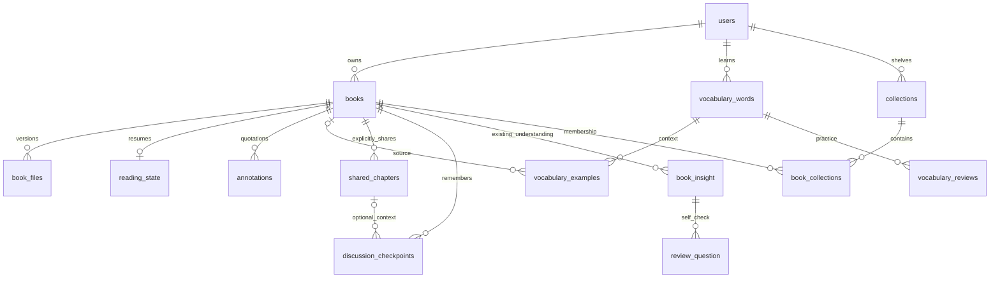

# V2 schema overview

**Status: Discussion · 2026-10-29.** A readable server schema proposal, not a migration.
Owner clarification: roughly 20 tables is a simplicity guide, not a hard cap. Prefer clear ownership
and understandable lifecycles to artificial merging. No database was accessed or changed.

Owner storage decision (2026-10-29): synced book files live on the server filesystem in persistent
storage, while PostgreSQL holds metadata and relative file keys. Existing R2 backups remain backups,
not the live book store. Docker may mount the persistent volume; Docker itself is not a storage provider.
An S3-compatible backend is a future option, not an extra service required for self-hosting V2.

## Proposed baseline: 23 application tables

This count includes existing authentication and transitional saved insights. It is not the guaranteed
final total: retained optional features below may add tables. Migration infrastructure is counted separately.

| # | Table | What one row means | Main fields / relationships |
|---|---|---|---|
| 1 | `users` | One account | Existing identity fields; proposed user learning preferences and staff authorization need review, not a new parallel admin identity. |
| 2 | `user_refresh_tokens` | One reader session token | User, token hash, expiry/revocation; retain current security semantics. |
| 3 | `password_reset_tokens` | One reset request | User, token hash, expiry. |
| 4 | `oauth_clients` | One registered MCP client | Existing OAuth client metadata. |
| 5 | `oauth_authorization_requests` | One pending authorization | Client, state/PKCE data, optional user, expiry; account deletion must not leave user-linked data. |
| 6 | `oauth_grants` | One MCP authorization grant | Owner, client, scopes, token hashes, expiry/revocation. |
| 7 | `device_authorizations` | One device-login attempt | Codes, client/owner binding, expiry and status. |
| 8 | `mcp_access_keys` | One existing direct MCP key | Owner, key hash, expiry/revocation. Retain until explicit retirement; do not merge token types to save a table. |
| 9 | `books` | One personal library entry | Owner, title, author, language, removal marker; proposed `checkpoint_saving_enabled` preference defaults off until opted in. |
| 10 | `book_files` | One exact file version of a book | Owner/book, SHA-256, size, format, original name, current-version marker, nullable server storage key. |
| 11 | `reading_state` | Accepted reading state for one book | Owner/book/file version, current locator, frontier, fraction, completion, revision/timestamps. |
| 12 | `annotations` | One saved quotation/highlight with its note | Owner/book, optional file/locator, selected text, note, color and deletion marker. Legacy quotes can be unanchored. |
| 13 | `vocabulary_words` | One word card for one reader/language | Original word, lowercase key, language, primary translation/definition, learning state and next review time. |
| 14 | `vocabulary_examples` | One contextual example for a card | Owner/word, sentence, contextual translation, optional book/file/chapter reference, source title and retry identity. |
| 15 | `vocabulary_reviews` | One completed word review | Owner/word, result, mode, response time, before/after learning state, timestamp and retry identity. |
| 16 | `shared_chapters` | One explicitly shared chapter snapshot | Owner/book, optional file version, chapter key/title, selected text/notes, content version/hash, shared time. |
| 17 | `discussion_checkpoints` | One saved stage of a discussion | Owner/book, optional chapter/share reference, topic, attributed thoughts/conclusions/open questions, language, operation id and save time. |
| 18 | `book_insight` | One existing saved insight or structured chapter review | Preserve existing content and tool semantics during transition; target references must stop depending on retired catalog chapters. |
| 19 | `review_question` | One existing self-check question | Owner, source insight/review and learning state; preserve rather than silently drop. |
| 20 | `reading_sessions` | One reading-time interval | Owner, optional book, start/end and duration, idempotent client session id. |
| 21 | `collections` | One named personal shelf | Owner, name and ordering metadata. |
| 22 | `book_collections` | Membership of a book in a shelf | Owner, book and collection; unique membership. |
| 23 | `llm_traces` | One diagnostic model invocation | Retain existing diagnostic purpose with explicit text retention; never substitute traces for user-visible discussion memory. |

These are candidate logical shapes, not a promise that unchanged legacy columns already support them.
Auth tables 1–8 are based on the current inventory. Their full DDL and protocol behavior are not redesigned here.

## Relationships that matter to the reader

All user-owned references must also enforce matching ownership, not only matching ids. A diagram is
not a substitute for composite foreign keys, owner-filtered queries and cross-owner integration tests.

## Why separate these tables?

- **Book versus file:** rename a book without changing its identity; replace a file without losing quotations.
  Old file metadata can survive without retaining the old bytes. Cloud metadata does not imply cloud upload.
- **Progress versus annotations:** resume state is replaced frequently; saved quotations are independent records.
- **Word versus examples versus reviews:** one card has one learning schedule, many contexts and many answers.
  Re-saving a word adds context, not another card or a reset schedule.
- **Shared chapter versus checkpoint:** the share is source context explicitly made available to MCP;
  a checkpoint is what the discussion worked out. Either may exist without the other.
- **Checkpoint versus current insight:** new checkpoints append; current `save_insight` has replace semantics.
  Keep both contracts during transition rather than silently breaking old tools. Consolidation can be
  assessed later, with explicit record kinds and compatibility rules; this extra table is not hidden.
- **OAuth tables:** different security lifecycles already exist. The reader redesign does not justify
  replacing them with a generic token bucket.

No `chat_messages` table is needed for the agreed first version. Per-book saving preference belongs
to `books`; it does not require a settings table or global conversation memory.

## Constraints and lifecycle contracts to express in SQL

- One current file version per owner/book; every anchored annotation identifies its file version.
- One reading-state row per owner/book; never apply old coordinates to incompatible file bytes.
- One active word card per owner/source-language/lowercase word key. Preserve distinct inflections.
  Precise lowercase rules and reactivation after deletion need a language/sync contract.
- Example and review retry keys prevent duplicate writes; different contexts are not duplicates merely
  because they contain the same word. Keep the primary translation and existing review progress on re-save.
- Checkpoint uniqueness is owner + operation id, not book + chapter. Same retry returns the same entry;
  a new thought in the same chapter gets a new entry. Changed payload under one operation id conflicts.
- Chapter references are file-version/resource keys, not server `user_chapters.id` values. Checkpoints
  need not require a chapter share; a share must not authorize other chapters automatically.
- Remove from library means a hidden book record, not cascading SQL deletion. Quotes, notes, shares
  and discussions remain accessible. Deleting each kind of saved content remains independently supported.
- Account deletion clears owned cloud records. Object-storage deletion, backup expiry, offline clients
  and already exported assistant content have separate cleanup boundaries.

Exact constraints, indexes and deletion actions are still to be reviewed. The
[nine-table SQL draft](v2-library-draft.sql) covers library, vocabulary, shared chapters and checkpoints,
including the per-book saving flag. It excludes legacy insights/auth/other retained tables. Its isolated
PostgreSQL validation passed [32 checks](v2-schema-validation.md); it has not been applied to any
application database. Lifecycle and retry gaps remain in the [draft notes](v2-library-draft.md).

## Existing features outside the 23-table baseline

Not being in the baseline is **not approval to delete a feature or its data**.

| Existing area | Proposed treatment / decision still required |
|---|---|
| Bookmarks | Either a dedicated `bookmarks` table (+1) or an explicitly typed annotation record. Current quote-required annotations cannot store location-only bookmarks unchanged. |
| Goals / achievements | Keep `reading_goals` and `user_achievements` (+2) if retained. Stats queries are not a reason to invent additional aggregate tables yet. |
| Vocabulary settings | Candidate small user preference object; compare existing settings before removing `user_vocabulary_settings`. |
| Word lookups / pending words | These are not saved cards. Decide whether the collection/queue workflows survive before collapsing or retiring their storage. |
| Word clusters / tutor | Retain `word_clusters` / `tutor_session` (+2) if those features remain. Vector infrastructure is not required merely to retrieve book checkpoints. |
| Server ingestion / quality jobs | Not needed to open local EPUBs. Existing PDF/quality features may still require their job tables until separately redesigned. Do not delete them from this proposal. |
| AI operations | `agent_run`, `eval_runs`, `models`, `model_promotions`: audit active behavior individually. Config can replace static configuration, not automatically audit/history records. |
| Admin settings / accounts | Propose ordinary user-based staff authorization and reviewed configuration. Keep current admin paths until security and configuration parity is established. |
| SEO / catalog / sites | Planned retirement within V2, after archive and data transition. No intermediate mass deletion authorized. |

Preserving all optional features may put the result above 23, which is acceptable if each table has a
clear role. The simplification goal is fewer competing models and hidden dependencies, not a forced number.

## Next slice and open questions

Review this logical schema, then extend the SQL draft for vocabulary and checkpoint/share ownership.
Keep the production schema untouched; executable migrations and Dapper ports follow bounded module specs.

- Keep bookmarks, goals, achievements and tutor features in the initial V2 release?
- Retain legacy insights alongside checkpoints initially? Recommended for compatibility.
- Which server PDF/quality and AI operational features remain active?
