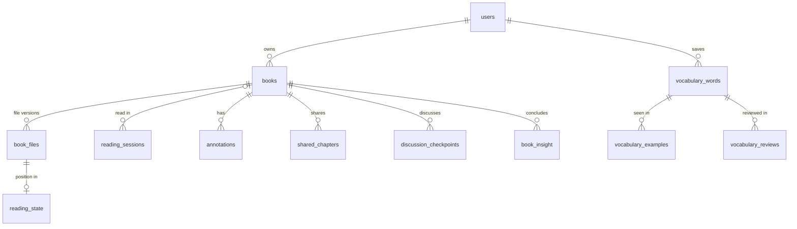

# Data Model

The one map of the PostgreSQL schema (`textstack_v2`, [ADR-031](adr/ADR-031-v2-schema.md)): every table
and what it is for. Column-level truth: [`database/migrations/`](../../database/README.md), the baseline
[`0000_baseline.up.sql`](../../database/migrations/0000_baseline.up.sql) plus every numbered migration
after it, read in order ([ADR-026](adr/ADR-026-sql-first-migrations.md)).

**Update this page in the same PR as any schema change.** A PR that adds, drops or reshapes a table
changes its row here.

## Tables

24 permanent tables + 2 transitional, created and migrated by `migrator` ([database/](../../database/README.md)).
The Origin column names the legacy table each one came from (the legacy database was dropped 2026-11-17).

| Module | Table | A row is | Origin |
|---|---|---|---|
| Identity | `users` | an account: reader, guest or staff (`role`) | `users` + `admin_users` |
| | `user_refresh_tokens` | a session | `user_refresh_tokens` + `admin_refresh_tokens` |
| | `password_reset_tokens` | a reset code | same |
| | `oauth_clients` | a registered MCP client | same |
| | `oauth_authorization_requests` | a pending OAuth authorization | same (+ `user_id` FK) |
| | `oauth_grants` | an MCP OAuth token pair | same |
| | `device_authorizations` | a device-flow login attempt | same |
| | `mcp_access_keys` | a `tsk_…` connect key | same |
| Library | `books` | a library entry | `user_books` (same id) + catalog `user_libraries` pairs (no file) |
| | `book_files` | an exact file version | `user_book_files` (same id) |
| Reading | `reading_state` | the accepted position + frontier for one book | `user_books.progress_*` |
| | `reading_sessions` | a reading interval | `reading_sessions` |
| Annotations | `annotations` | a highlight + note, or an unanchored quotation | `highlights` |
| Vocabulary | `vocabulary_words` | one card per owner/language/word_key | `vocabulary_words` |
| | `vocabulary_examples` | a source sentence for a card | `vocabulary_words.sentence` / `book_title` |
| | `vocabulary_reviews` | one answer | `vocabulary_reviews` |
| Discussion | `shared_chapters` | an explicit chapter snapshot for MCP | new |
| | `discussion_checkpoints` | one saved stage of a discussion | new |
| | `book_insight` | an assistant conclusion or chapter review | `book_insight` (one `book_id`) |
| Ops | `llm_traces` | one LLM call | same |
| | `agent_run` | one agent run | same (− `edition_id`) |
| | `eval_runs` | one eval score | same |
| | `admin_settings` | one runtime knob | same |

## Core relationships

Every owned row carries `user_id`; children key on `(user_id, book_id)` composite FKs, so a row can
never point at another user's book.

## PII / GDPR map

| Table | Fields | Notes |
|-------|--------|-------|
| `users` | email, name?, picture?, google_subject?, apple_subject?, last_active_at | Primary PII; admins are `role = 'admin'` |
| `user_refresh_tokens`, `password_reset_tokens` | user id + token hash | Sessions, reset codes |
| `reading_state`, `reading_sessions` | user_id | Behavioural |
| `vocabulary_words`, `vocabulary_examples`, `vocabulary_reviews` | user_id | Learning patterns |
| `annotations`, `shared_chapters`, `discussion_checkpoints`, `book_insight` | user_id | Annotations, assistant output |
| `mcp_access_keys`, `oauth_grants`, `device_authorizations`, `oauth_authorization_requests` | user id | Credentials |
| `llm_traces`, `agent_run` | prompt/response text (scrubbed before write) | Traces carry no user id; their text goes after 30 d. Agent runs are deleted with the account |
| `books`, `book_files` | user_id | Uploaded content + library |

**Guest users**: `users.is_guest = true` ([ADR-014](adr/ADR-014-guest-sessions.md)). Nothing sweeps
abandoned guests today (see [STATUS.md](../STATUS.md)). **Account deletion**: `DELETE /me/account`
(`AccountEndpoints.cs`) deletes the `users` row; every owned table cascades from it. Retention:
`RetentionCleanupWorker` (daily).

## Migrations

Plain SQL `up`/`down` files in `database/migrations/`, applied only by the `migrator` container
([ADR-021](adr/ADR-021-migrations-owned-by-the-migrator.md), [ADR-026](adr/ADR-026-sql-first-migrations.md));
a schema behind the Api's build shows as `/health/ready` 503. How to add one: [database/README.md](../../database/README.md).

## See also

- [../internal/ops/backup.md](../internal/ops/backup.md) — backup + restore drill
