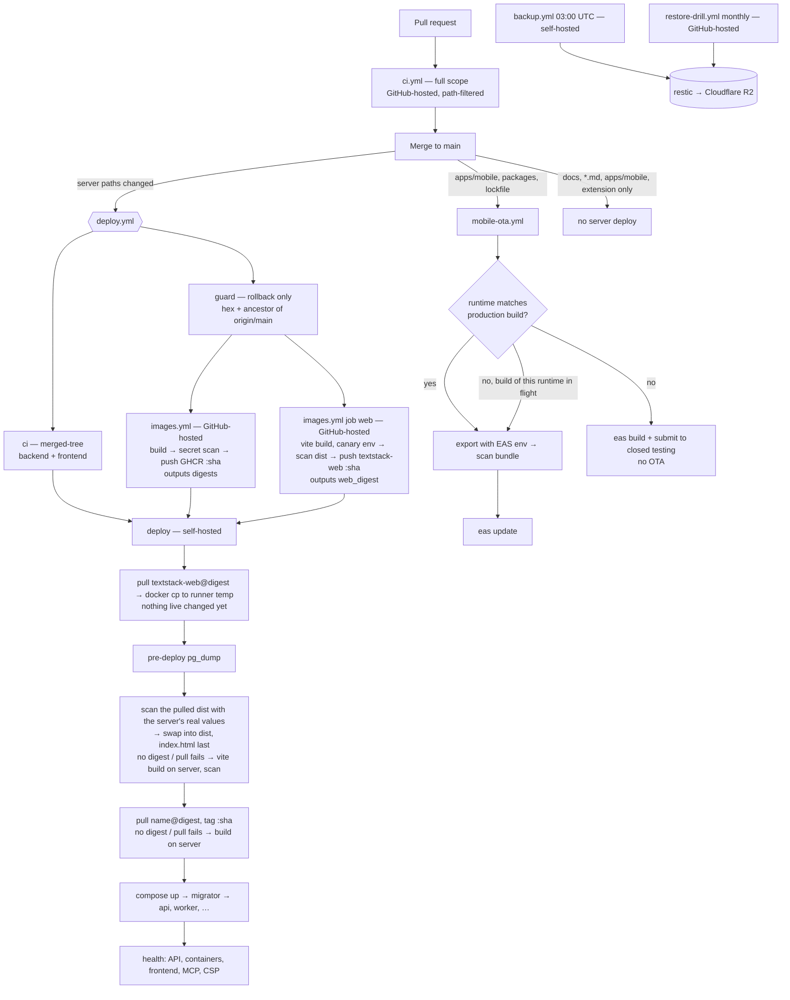

# Delivery pipeline

How a commit reaches production, what it depends on, and what keeps a secret out of it.
Decision record: [ADR-020](adr/ADR-020-build-once-deploy-by-digest.md). Source review: 2026-10-06,
after #742. Verified against `.github/workflows/` on 2026-10-06; web bundle section 2026-10-07.

## Goal

**Ship faster, security first, zero secret leaks.** In that order of tie-break: a change that makes
delivery faster but lets a secret reach an image, a bundle or a log does not ship.

- Merge → live in **~8–9 min** for a backend or web change once the slim Dockerfiles land
  (max(CI ≈ 6, images ≈ 5) + deploy ≈ 2). Mobile, extension and docs merges cost the server **0 min**.
- Every artifact a user or the public can download — GHCR images, `apps/web/dist`, the OTA bundle —
  is scanned for secrets before it ships. Secrets exist only at runtime: the server's `.env`, GitHub
  secrets, EAS secrets.

## Flow

`deploy` needs `ci` (and `guard` on a rollback); `images` — both jobs — is allowed to fail (the server
builds instead). The pre-deploy dump is a step inside `deploy`, before the web
swap: a failed dump ships nothing, and the dump is a minute or two (web scan + swap) before the
migrator — see "Known limits" for why it is not parallel.

**The web bundle** is built, canary-scanned and pushed on GitHub (`images.yml` job `web`) as
`textstack-web:<sha>`, a `FROM scratch` image holding only `/dist` — never run, only copied out
(`docker create` + `docker cp`). The deploy scans it again with the server's real secret values and
only then swaps it in (`infra/scripts/swap-web-dist.sh`): assets first (content-hashed, unreachable until
named), every other file renamed into place, `index.html` last, files the previous release shipped and
this one does not removed, assets referenced by nothing pruned — keeping the previous `index.html`'s
graph (open tabs). The build-time
`VITE_*` values live in `apps/web/production.env`, the one file both builds read.

## Images

Compressed size (what CI pushes and the server pulls), after #748:

| Image | Base | Size | Notes |
|---|---|---|---|
| api | `aspnet:11.0-alpine` | ~93 MB | single-RID publish (`linux-musl-<arch>`) |
| worker | `aspnet:11.0-alpine` | ~110 MB | no Node/browser, no book parsers (ADR-033); ICU on |
| admin | `nginx-unprivileged:stable-alpine` | ~26 MB | static `dist` on :81, SPA fallback |
| migrator | `alpine:3.24` | ~22 MB | `postgresql16-client` + `database/` (`migrate.sh` and the SQL files, [ADR-026](adr/ADR-026-sql-first-migrations.md)); was an EF Core migrations bundle (~89 MB) until 2026-10-26, and the full SDK (~1.4 GB) before 2026-10-07 |
| mcp-server | `aspnet:11.0-alpine` | ~53 MB | Sentry added +0.35 MB |
| web | `scratch` | ~3.8 MB on disk | `apps/web/dist` (vite output + `public/`) under `/dist`; no OS, no shell, never started |

## External dependencies

| dependency | used for | if it is down | fallback |
|---|---|---|---|
| GitHub repo + Actions (hosted runners) | CI, images build, OTA, restore drill, health check | No CI, no deploy, no images | Break-glass by hand on the server (`git pull` + `compose up --build`). Not yet a runbook in `docs/03-ops`. |
| GitHub self-hosted runner service | deploy, pre-deploy + nightly backup | No deploy, no nightly backup (site stays up) | Run the same steps by SSH; backups also in R2 |
| GHCR | published images; `ghcr-retention.yml` prunes them weekly | Pull fails; retention run fails (deletes nothing) | Deploy falls back to a server build |
| Docker Hub | `node`, `debian` (scanner), `alpine`, `pgvector`, `restic` | Image builds and scans fail; nightly R2 backup fails (restic) if not cached; prod keeps running on cached images | Images cached on the server. If it hurts: mirror bases to GHCR or use `mirror.gcr.io` / `public.ecr.aws/docker/library` |
| MCR (mcr.microsoft.com) | .NET SDK/runtime, Aspire dashboard | .NET image builds fail | gha layer cache; server cache |
| npm registry (+ corepack pnpm download) | all JS installs: CI, images (incl. the web bundle), the server's fallback web build | CI and images fail; the deploy's server fallback fails too | none (cache in CI only) |
| NuGet.org | .NET restore | CI and image builds fail | gha layer cache covers unchanged restores |
| Alpine / Debian apt mirrors | `apk add`, `apt-get install` in Dockerfiles | Image build fails on cache miss | Retry loop (Worker); gha cache. The secret scan needs no mirror. |
| storage.googleapis.com (Chrome for Testing) | Puppeteer browser download (the server's fallback `pnpm install` and CI `frontend` only; images and the web job skip it, the Worker has no browser since #748) | A fallback build fails on cache miss (blocked a deploy 2026-08-20) | Backoff loop |
| Cloudflare DNS + SSL + Tunnel | all public traffic to the home server | **Site down** | None quick. Keep a way to repoint DNS; the tunnel is the only ingress |
| Cloudflare R2 | off-site restic backups | Nightly off-site step fails (email); local backups still made | Local copies on the server (2 newest) |
| Home server, ISP, power | everything at runtime | **Site down** | R2 backup + restore drill (RTO measured monthly); no warm standby |
| Expo EAS (build, update, submit, env) | OTA updates, Android builds, OTA bundle env | No mobile releases; installed apps keep working | Local `eas build --local` |
| Google Play | Android distribution | No new releases | none |
| Apple App Store | iOS (later) | — | — |
| OpenAI | translate, explain | Those features fail; reading works | explain/translate file caches |
| Edge TTS (speech.platform.bing.com) | text-to-speech | TTS fails for uncached text | Disk + IndexedDB cache |
| Google OAuth / Apple Sign-In | sign-in | Those sign-ins fail | Email/password; guest reading |
| Resend | password reset, admin alerts | No emails | none |
| Sentry | errors (api, worker, mcp-server, web; mobile in its own project) + 20 % of API request traces | Blind to errors; app unaffected (no DSN = SDK never loaded) | Container logs (`docker compose logs`, 5 × 10 MB per service) |
| Open Library | metadata/cover lookups | Missing enrichment | none needed |
| Google Fonts, Google Tag Manager | web fonts, analytics | Fallback fonts, no analytics | none needed |

Single points of failure that matter: **the home server + Cloudflare tunnel** (runtime) and
**GitHub** (delivery). Everything else degrades one feature or blocks one build.

## Observability

What reaches the owner, and what deliberately does not exist.

| signal | where it goes | covers |
|---|---|---|
| Errors | Sentry, one project (`dotnet-aspnetcore`), filtered by the `service` tag: `api`, `worker`, `mcp-server` | api, worker, mcp-server: anything logged at Error (the API's unhandled exceptions arrive through `ExceptionMiddleware`'s `LogError`). mcp-server logs one when a tool's mapping breaks — before 2026-10-07 that branch reported nothing. |
| Request traces | Sentry, API only: 20 % of `http.server` (`SentryBootstrap` default; compose does not forward `Sentry__TracesSampleRate`), every AI agent run, never `/health` | Latency and the AI routing spans. No other service sends transactions. |
| Mobile crashes | Sentry project `textstack-mobile` | The reader app (its own scrubber, `apps/mobile/src/lib/sentryScrub.ts`) |
| Uptime | `health-check.yml` every 5 min (GitHub email); UptimeRobot (see [`uptime-monitoring.md`](../internal/ops/uptime-monitoring.md)) | Both hosts, API body, readiness, schema |
| Metrics | **none in production** | — |

**OpenTelemetry is off in production.** Traces, metrics and logs are exported over OTLP only when
`OTEL_EXPORTER_OTLP_ENDPOINT` is set; without it nothing is registered (`TelemetryExtensions`). Until
2026-10-07 production pointed it at `aspire-dashboard`, a container behind the `observability` profile
that the deploy never starts: every batch was built, failed to resolve and was dropped, with no log line
(the exporter reports through an EventSource). Aspire is still the local tool — `docker compose
--profile observability up -d aspire-dashboard`, `OTEL_EXPORTER_OTLP_ENDPOINT=http://aspire-dashboard:18889`
in `.env`, UI on `127.0.0.1:18888` — and keeps telemetry in memory only.

**SDK defaults overridden for every .NET host** (`SentryBootstrap.Apply`):

| default | ours | why |
|---|---|---|
| DiagnosticSource integration on | **off** | It records Npgsql `db.*` spans whose description is the full SQL. API traces lose their database child spans; the `http.server` transaction, outgoing-HTTP and AI spans stay. `ScrubTransaction` also blanks any `db.*` description. |
| `CaptureFailedRequests` true | **false** | A failed outgoing call (OpenAI, Edge TTS, Open Library, the bridge's API calls) is reported by the code that made it; the SDK's extra event would double it and carry the URL. |
| `TracePropagationTargets` `.*` | **empty** | No `sentry-trace`/`baggage` headers to anyone: every downstream is a third party, and no service of ours continues another's trace. |
| HTTP handler on every `HttpClient` | **off on mcp-server** (`DisableSentryHttpMessageHandler`) | That host sends no traces; the handler would only add headers and URL breadcrumbs. Kept on API/Worker for the outgoing-HTTP spans in API traces. |

**If metrics are wanted later:** a hosted OTLP backend (e.g. Grafana Cloud's free tier) is the
endpoint plus an auth header — no code change. It is the owner's call because of cost and privacy:
OTLP traces carry full SQL text (`SetDbStatementForText`) and the client IP (`http.client_ip`), and
none of it passes the Sentry scrubber. Strip both before pointing production at a third party.

**Privacy (the policy's promise).** Every service scrubs before sending, by allowlist: tags and
extras not blessed are dropped or redacted; no user, no cookies, no request bodies, no query strings;
free text loses credentials (bearer, every issued prefix — `tsk_`, `tso_`, `tsr_`, `tsc_` — JWTs) and
query strings, and is truncated.
The .NET hosts share `TextStack.Observability` (`SentryScrubber`), which also redacts emails, phones and
the `/mcp/k/<key>` segment; mcp-server additionally drops exception messages (tool arguments are the
reader's text) and keeps Information lines out of breadcrumbs. A local `Development`
environment reports nothing on any service.

## Security controls

| control | where | what it stops |
|---|---|---|
| Secrets only at runtime | server `.env`, GitHub secrets, EAS secrets | Nothing secret is a build input. Images are public. |
| Image secret scan gates the push | `images.yml` → `infra/scripts/scan-image-secrets.sh` | Every `.env.example` name **and every `${VAR}` in the compose files** is a canary; a canary, token shape, private key or secret-named file in `Config.Env`, history or **any single layer** (incl. files deleted later) fails the job before anything is pushed. |
| Web bundle scan gates the push | `images.yml` job `web` | The build runs with every `.env.example` / compose `${VAR}` name set to a canary; the whole `dist` is scanned (patterns + canaries) before `textstack-web` is pushed. |
| Web bundle scan gates the swap | `deploy.yml` "Secret scan web dist" | The pulled `dist` again, with the server's real values of `*SECRET`, `*PASSWORD`, `*TOKEN`, `*API_KEY`, **before** "Put web bundle live" — a hit stops the deploy with nothing live changed. Defence in depth (seconds; the only check that knows production's values). On the fallback: vite's output (`index.html` + `assets/`) after the build. Stray `apps/web/.env*` files are moved aside before any vite run. |
| OTA bundle scan | `mobile-ota.yml` | Same patterns over an `expo export` made with the EAS production environment, plus `EXPO_TOKEN`'s value; gates `eas update`. |
| `.dockerignore` | repo root | `.env*`, keys, service accounts, `appsettings.*.json`, `bin/`, `obj/` never enter a build context. |
| Actions pinned by SHA | every `uses:` in `.github/workflows/` | A moved tag cannot change code that runs next to `EXPO_TOKEN`, a write token or the self-hosted runner. Dependabot bumps the SHA and the `# vX.Y` comment. |
| Images pinned by digest | `docker-compose.yml`, `backup.yml` (restic), scanner, Makefile; every Dockerfile `FROM` (#748; `tools/checks/check-node-version.mjs` requires the node FROM to be a literal pinned `.nvmrc` version) | A re-pushed tag cannot swap the DB, the backup tool (sees R2 keys and `.env`) or the scanner. Dependabot (`docker`, `docker-compose`) bumps them weekly. |
| Deploy pulls by digest | `images` output → `deploy` | A `:sha` tag re-pushed between build and pull is ignored; the server runs the bytes that passed the scan. |
| Rollback input guarded | `deploy.yml` `guard` | `rollback_commit` must be 7–40 hex, resolve in a full clone, and be an ancestor of `origin/main`; passed via `env:`, never interpolated into `run:`. |
| Least-privilege tokens | top-level `permissions:` in every workflow | Read-only (or none) by default; only `images` (packages: write), `ghcr-retention` (packages: write, actions: read), `deps-refresh` (contents + PRs) and `publish-mcp-nuget` (id-token) widen, per job. |
| Fork-PR approval | repo setting `all_external_contributors` | No outside PR runs any workflow without the owner's click. |
| Self-hosted runner never runs `pull_request` | `ci.yml` is all `ubuntu-latest`; no `pull_request_target` anywhere | PR code never touches the prod box. Keep it that way. |
| Push protection + secret scanning | repo settings | First line: a secret in a commit is refused at `git push`, before any image exists. |

## Known limits

- **The web scan is before the fact only on the normal path.** On the server fallback (no
  `web_digest`, a failed pull, a rollback to a commit before `apps/web/production.env`) vite builds
  into the served `dist/` as it always did, so a hit there stops the deploy but the bundle is already
  live. The fallback also brings back npm install + postinstalls on the production host, and Node must
  match `.nvmrc` there (checked, fallback only).
- **The web bundle differs from what the server used to build, on purpose.** Until 2026-10-07 the
  server's build did not match the lockfile: production shipped react 19.2.6 and DOMPurify 3.4.3 while
  `pnpm-lock.yaml` (and CI, and every local build) has react 19.2.3 and DOMPurify 3.4.16 — leftovers in
  the server's `node_modules` that `--frozen-lockfile` did not replace. The GitHub build is a clean
  install, so the first pulled deploy moves production onto the locked versions (same `VITE_*` values;
  a Linux and a macOS build of the same commit are byte-identical). The server's `node_modules` stays
  stale for the fallback until someone deletes it.
- **Asset pruning keeps one release of grace.** A tab opened two releases ago that lazy-loads a chunk
  gets a 404. The fallback path has no grace at all.
- **The OTA scan checks an equivalent bundle**, not the uploaded bytes (`eas update` bundles again
  from the same commit and environment). EAS store builds bundle on Expo's servers and are not scanned.
- **Pins Dependabot cannot see:** the scanner (`debian:13-slim`) in the scan script, restic in
  `backup.yml`, alpine in the Makefile, `node:${NODE_VERSION}-alpine` (ARG form). Bump by hand:
  `docker buildx imagetools inspect <image:tag>`.
- **Rollback to an already-published SHA** takes its digest from the registry at that moment (no
  push happened in this run to report one).
- **The pre-deploy dump stays on the critical path (~2.5 min), on purpose.** Running it in a parallel
  job at the start of the run would put CI and images between the dump and a bad migration, and their
  writes would be lost on restore. It runs before the web swap, so a failed dump changes nothing live; the gap to the migrator is the web
  scan + swap (a server build on the fallback), a minute or a few. Correctness of the rollback point beats 2.5 minutes.
- **The scanner a deploy runs is the workflow commit's** (`git show $GITHUB_SHA:scripts/…` into
  `$RUNNER_TEMP`), so a rollback to a commit older than the script still scans and finishes.
- **One non-ephemeral self-hosted runner, repo-level.** A `workflow_dispatch` from another branch
  runs that branch's workflow on it (write access required). Limiting the runner to `deploy.yml` /
  `backup.yml` on `main` needs an org runner group.
- **The deploy gate does not check the schema.** It waits on `/health` (liveness). The migrator
  exiting non-zero already stops the deploy (`api` needs `service_completed_successfully`); any other
  schema behind the build is caught by `health-check.yml` "Schema matches the build" within 5 min, not
  by the deploy ([ADR-021](adr/ADR-021-migrations-owned-by-the-migrator.md)).
- **Free disk space** in `images.yml` stays until the slim Dockerfiles land and a run shows the room.
- **GHCR packages are public**: they expose OS patch levels and the deploy cadence. Accepted.
- **GHCR retention** (`ghcr-retention.yml`, weekly + manual dry run). Public packages cost nothing
  to store; it runs because seven images per merge, ~10 merges a day, is ~400 versions a week nobody
  reads. Per package it keeps the newest 10 tagged, anything younger than 14 days, the SHAs of the
  last 5 successful deploys **and of every deploy run since the oldest of them** (a failed run may
  have reached `compose up`), any non-SHA tag, and every manifest a kept index references; the rest
  goes, oldest first, at most 150 per package per run. Any API failure before the first delete
  (deploy runs, listing, a manifest) deletes nothing; a package that does not exist yet (404 — `textstack-web` before its first push) is skipped. A rollback deploys `rollback_commit`, not its
  run's `head_sha`, and the API does not expose inputs — so `deploy.yml`'s `run-name` is
  "Rollback to <sha>" and the script reads it; **keep that run-name**. A rollback to a SHA already
  pruned still works: `images` rebuilds it for that ref (or the server does), slower. Deleting with
  `GITHUB_TOKEN` relies on the repo holding the admin role on each package (automatic for packages
  a workflow published) and on the REST path `users/<owner>/…` — a move to an org account changes it
  to `orgs/<org>/…`. GitHub calls workflow deletion via REST "public preview".
  Rollbacks before this `run-name` have the default title "Deploy"; none ran after images were first
  published (#742, 2026-10-06 — the last dispatched deploy was 2026-03-25), so none is unprotected.
  Fewer than 5 successful deploys in the 30-day window (the re-run limit) fails the run closed.
  So does a listing that lacks the newest successful deploy run of the newest main commit that has
  one (main's commits paged back to the window, each looked up by `head_sha`, independently of the
  listing), or no such run in the window: under `GITHUB_TOKEN` the listing once came back
  self-consistent but four days stale (2026-10-07). Live is the listing's newest by start time, so a
  re-run of an old rollback counts.
  **Race:** a rollback started after a retention run has listed the deploy runs is not protected by
  it; if that run deletes the target's version, the deploy's pull by digest fails and the server
  builds instead — slower, not broken.
- **Scan blind spots:** nested archives (zip, nupkg, jar, tgz) are not unpacked; token shapes outside
  the regex (Resend `re_`, `GOCSPX-`, `gho_`/`ghs_`, `npm_`, R2 hex keys, the JWT secret) are caught
  only by value in the dist scan, not in images. Push protection is the first line.

## Where to change what

| to change | edit |
|---|---|
| Which pushes deploy | `deploy.yml` `paths-ignore` — never add `packages/**`, the lockfile or `pnpm-workspace.yaml` |
| The list of published images | `SERVICES` in `images.yml` **and** the service loops in `deploy.yml` "Deploy containers" (the web image is its own job and step: `images.yml` `web`, `deploy.yml` "Fetch web bundle") |
| The web build's `VITE_*` values | `apps/web/production.env` — read by `images.yml` `web` and by the deploy's fallback build; public by design, never a secret |
| How the web release goes live | `infra/scripts/swap-web-dist.sh` (self-check `infra/scripts/swap-web-dist.test.sh`, run by `ci.yml` `frontend`) |
| Secret patterns, allowlist, scanner image | `infra/scripts/scan-image-secrets.sh` (`CONTENT`, `PEM`, `NAMES`, `ALLOW`, `SCANNER`) |
| Which server values the web scan treats as secret | `deploy.yml` "Secret scan web dist" (the awk name filter) |
| An action version | Let Dependabot do it; by hand: `gh api repos/<owner>/<repo>/commits/<tag> --jq .sha`, keep the `# vX.Y` comment |
| A pulled image version | `docker-compose.yml` `image: name:tag@sha256:…` (Dependabot weekly); restic/scanner/Makefile by hand |
| Pre-deploy backup | `deploy.yml` step "Pre-deploy backup" (before the web swap or build); nightly + R2: `backup.yml`; drill: `restore-drill.yml`; ops: [`backup.md`](../internal/ops/backup.md) |
| Rollback | Actions → Deploy → Run workflow → `rollback_commit` = a SHA on main |
| Workflow permissions | top-level `permissions:` stays read/none; widen per job |
| GHCR retention | `ghcr-retention.yml` env (`KEEP_NEWEST`, `KEEP_DAYS`, `DEPLOYS`, `MAX_DELETE`, `PACKAGES` = `SERVICES` in `images.yml` + `web`); rules in `infra/scripts/ghcr-retention.mjs`. Preview: Actions → GHCR retention → Run workflow (dry run is the default) |
| Database schema / rollback | Only the `migrator` service migrates ([ADR-021](adr/ADR-021-migrations-owned-by-the-migrator.md)); rollback `docker compose run --rm migrator down <version>` ([ADR-026](adr/ADR-026-sql-first-migrations.md)) with the **current** image, **before** `rollback_commit`. Behind-schema alarm: `health-check.yml` step "Schema matches the build" |
| What Sentry may receive | .NET: `backend/src/Observability/TextStack.Observability/SentryScrubber.cs` (+ `McpHosts.ConfigureSentry`); web: `apps/web/src/lib/sentry.ts`; mobile: `apps/mobile/src/lib/sentryScrub.ts`. Change all three together, and the privacy policy if the promise changes |
| OpenTelemetry export | `OTEL_EXPORTER_OTLP_ENDPOINT` in the server `.env` (unset = off) |
