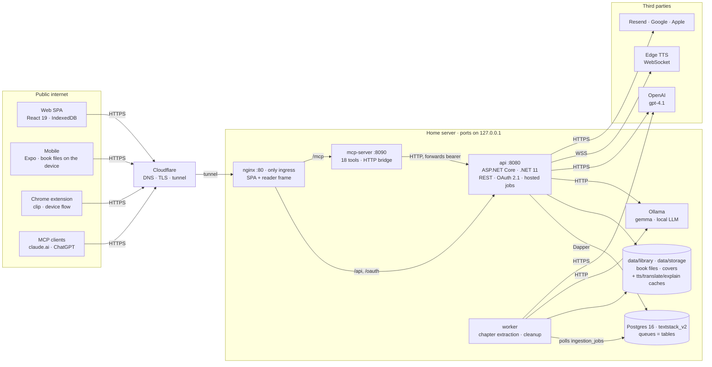
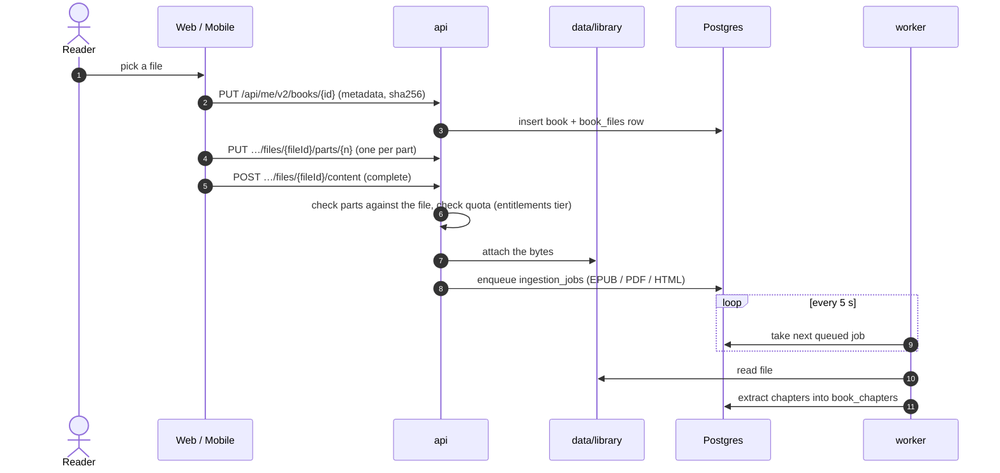
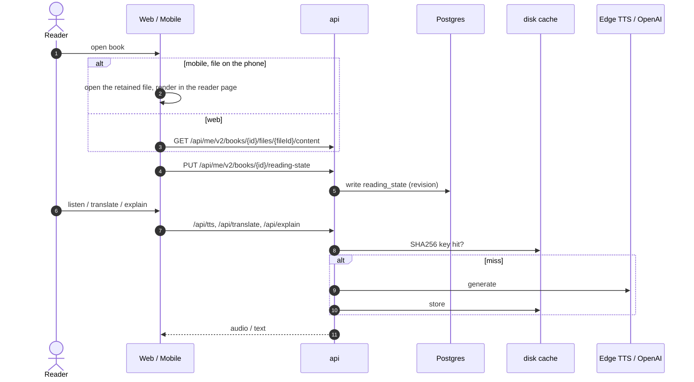
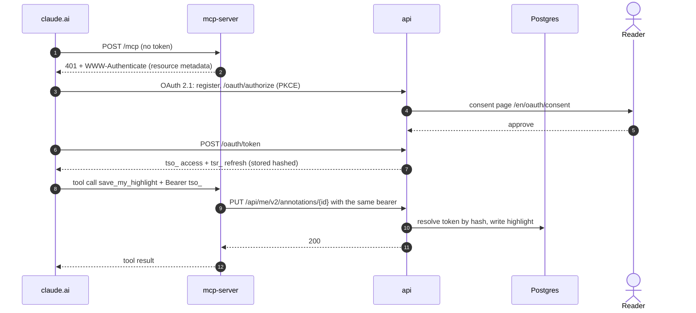

# How a book moves through TextStack

The runtime view. [README.md](index.md) lists the parts; this file shows how requests move
between them, one diagram per scenario (C4 "dynamic" view). Updated for V2-only on 2026-11-17.

## The map

One API, one worker, one Postgres, three clients and an MCP bridge. Queues are Postgres tables
that a worker polls; there is no broker. Everything runs on one home server behind a Cloudflare
tunnel, and all ports bind to `127.0.0.1` — nginx is the only way in.

Not drawn: admin shell (`textstack.dev`), migrator, Sentry, Aspire dashboard.

## 1. Upload a book

- The reader never waits for the worker: it opens the file itself. `book_chapters` is transitional and
  feeds the MCP chapter tools and clips.
- The queue is a table (`ingestion_jobs`), one consumer, `IngestionWorker`.
- Sync protocol (revisions, `operation_id`, parts): [v2-sync-protocol.md](../internal/v2/v2-sync-protocol.md).

## 2. Read a book

Detailed behavior: [open a book and resume](../internal/v2/reader-open-resume.md).

- Mobile reads offline: the file and the local library live on the device; sync runs beside it.
- The reader is our foliate-js fork in a sandboxed page ([ADR-029](adr/ADR-029-foliate-for-v2-epub.md), [ADR-032](adr/ADR-032-one-engine-foliate-fork.md)).
- Every paid or slow call (TTS, translate, explain) is behind a disk cache, so a repeat costs nothing.

## 3. Claude via MCP

- The bridge holds no state and no secrets. It only forwards the bearer; the API checks it.
- Tokens are stored as hashes, so a DB leak does not leak working tokens.
- Assistant writes have a per-user rate limit.

## 4. Background work

Hosted services in api and worker: chapter extraction, retention cleanup, the TTS cache sweep.
See [index.md](index.md#background-work).

## Trust boundaries

| Who | How they prove identity | Where it is checked |
|-----|-------------------------|---------------------|
| Web / mobile users | JWT access (60 min) + rotating refresh. Google, Apple, email or guest | Endpoints call `GetUserId` |
| Claude, ChatGPT | OAuth 2.1 + PKCE, hashed `tso_`/`tsr_` tokens, scope `library` | API (`McpKeyAuth`); the bridge only forwards |
| Extension, stdio MCP | Device-flow JWT or `tsk_` connect key | API (`McpKeyAuth`) |
| Admin | Separate `admin_access_token` cookie | `AdminAuthMiddleware` on `/admin/*` |
