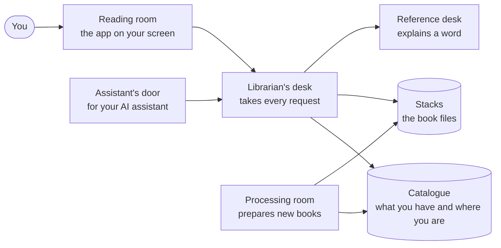
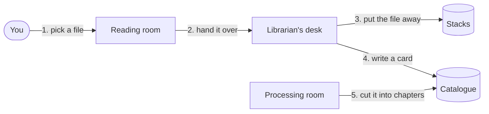
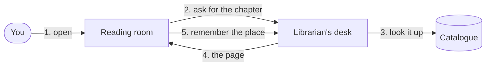
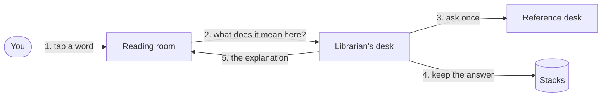
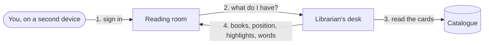
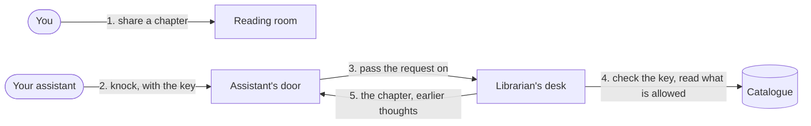
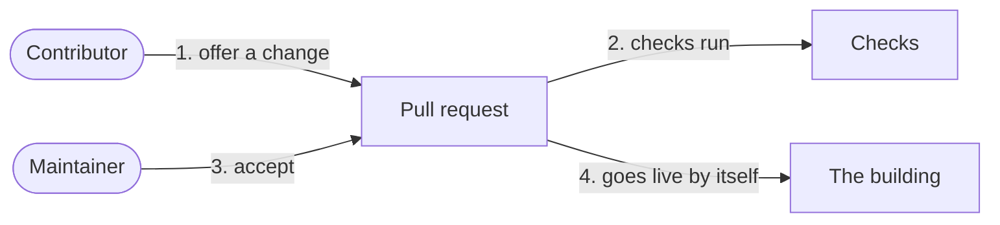

# How TextStack works: a book's journey

Think of TextStack as a small library building. This page walks one book through it, room by room.
No code. Each room has a plain name here and a technical name you will meet later; the technical
name is given once, in brackets.

## The building

- **Reading room** (the web app and the Android app): where you see your library and read.
- **Librarian's desk** (the API): every request goes through it. It checks who you are.
- **Catalogue** (the database): the list of your books, your reading position, your highlights,
  your words.
- **Stacks** (file storage): the book files themselves.
- **Processing room** (the worker): prepares a new book so it can be read. Works in the background.
- **Reference desk** (outside services): explains or translates a word, and reads text aloud.
- **Assistant's door** (the assistant bridge): a side door for your AI assistant. It needs a key.

Nothing reaches the catalogue or the stacks except through the desk or the processing room.

## Scene 1. You add a book

You pick a book file. The desk puts the file in the stacks and writes a card for it in the
catalogue. Then the processing room takes the book and cuts it into chapters. This takes a moment,
so the reading room shows "processing" until it is done.

This is [story 1](../stories/index.md).

## Scene 2. You open the book

The reading room asks the desk for the chapter and shows it. As you read, it tells the desk where
you are, and the desk writes your reading position in the catalogue.

On Android, a downloaded book is read from the phone first. The network is asked afterwards, and
only to refresh. That is why reading works offline.

## Scene 3. You tap a hard word

The desk asks the reference desk for a short explanation that fits this book. It keeps the answer,
so the same question is never paid for twice. If the reference desk is closed, reading still works.

When you save the word, the desk adds it to your vocabulary in the catalogue.

This is [story 3](../stories/index.md).

## Scene 4. You come back on another device

The catalogue is the memory. A new device asks the desk, and the desk reads your cards: your
books, your reading position, your highlights, your words.

This is [story 2](../stories/index.md).

## Scene 5. Your assistant comes in

Your assistant never walks into the building. It knocks at its own door with the key you gave it.
The door only passes requests on. The desk checks the key and decides what the assistant may see.
After the move to V2 that is only the chapters you chose to share, and what you worked out before.

What you and the assistant conclude is saved back the same way, through the desk.

This is [story 5](../stories/index.md).

## Scene 6. A change arrives

The building changes while it stays open. A contributor offers a change, the checks run by
themselves, a maintainer accepts it, and it goes live with no one copying files by hand.

This is [story 8](../stories/index.md). To do it yourself: [Ship a first pull request](../start/first-pr.md).

## What is being rebuilt

TextStack is moving to **V2**: a new catalogue and a new reading room. Two things change for the
book's journey:

- A book will open straight from its file. The processing room will no longer cut it into chapters
  first.
- Reading will not need the desk at all for a book that is on your device.

The old rooms stay open until the move is done. More: [the move to V2](v2.md).

## Words used here

Every word for a thing you work with (book, library, reading position, highlight, word, insight)
is in the [glossary](../glossary.md).

## Go deeper

- [The parts, by their technical names](index.md)
- [The same journeys, request by request](flows.md)
- [The data](data-model.md)
