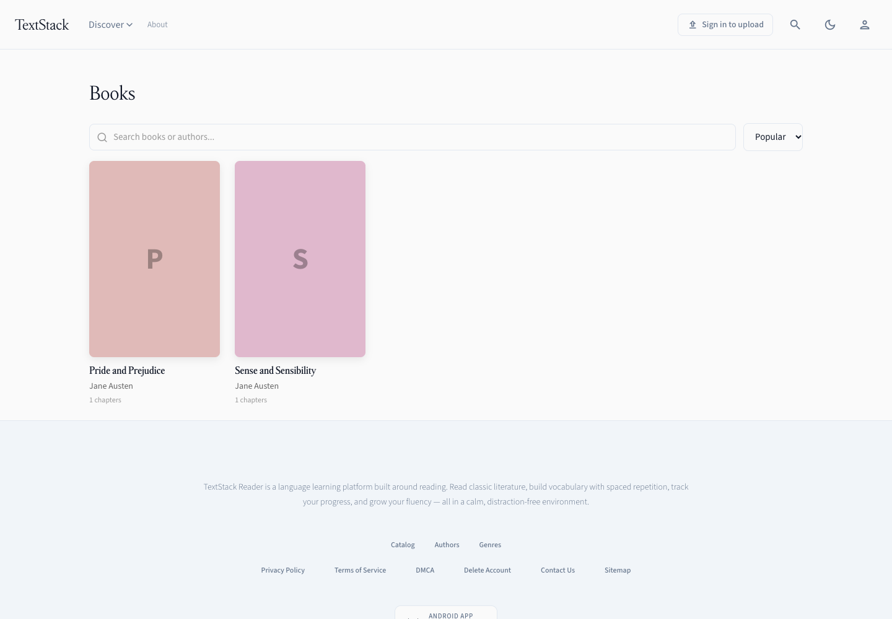

# TextStack typography

## Roles

- TextStack: wordmark, headings, book titles and serif reading mode. The four user-provided TTF styles are bundled unchanged.
- Source Sans 3: interface text and sans reading mode. Web uses the existing Google Fonts delivery convention; native screens bundle Regular, Medium and Semibold from Adobe's release branch with the SIL OFL license.
- OpenDyslexic: existing accessibility option, unchanged.
- New reading defaults: 20px / 1.6. Existing storage keys and saved preferences are preserved; 1.65 spacing remains selectable.

## Web

`--font-serif` and `--font-sans` define the two roles. TextStack uses `@font-face` with `font-display: swap`, preloading Regular. Georgia / Times New Roman / browser serif remain fallbacks. Reader chapter headings inherit the selected reader family.

## Native mobile and offline reader

Expo loads TextStack's four named styles and Source Sans 3's three interface weights for native screens. Shared typography tokens and existing literal font references use these registered names.

The WebView reader cannot use Expo's native font registry. `src/lib/readerFonts.generated.ts` therefore embeds TextStack's four faces and Source Sans 3 Regular as data URIs, following the existing offline OpenDyslexic approach. The generated HTML makes both standard families available so a Serif/Sans switch changes live CSS without rebuilding the chapter or losing its position. OpenDyslexic keeps its existing conditional face and document identity behavior. Sans bold/italic use browser synthesis.

After replacing native font assets, run `pnpm -C apps/mobile build:reader-fonts`. Tests verify that generated data matches the native assets and TextStack's web copies. The inline font payload adds approximately 1.9 MB to the reader document. Original-layout PDF content is unaffected.

## Provenance and unresolved distribution rights

The user supplied files from `~/Downloads/TextStack Fonts/`. All four are byte-identical to the corresponding Michelangelus files in the [official Microsoft download](https://www.microsoft.com/en-us/download/details.aspx?id=108856). CSS exposes them as `TextStack`; internal font names remain unchanged.

The accompanying EULA is retained beside the font files in each app. It grants no redistribution or sublicensing rights. No separate license permitting web or app redistribution has been supplied. Renaming the files does not establish those rights; release clearance remains unresolved.

Source Sans 3 files come from [Adobe's official release branch](https://github.com/adobe-fonts/source-sans/tree/release/TTF), with its license in `apps/mobile/assets/fonts/SourceSans3-LICENSE.md`.

## Verification — 2026-10-16

- Web production build passed; Vite reports a large-chunk warning. Full web suite: 129 files, 923 tests passed, 2 skipped.
- Mobile typecheck passed; full suite: 96 files, 793 tests passed.
- Expo exports for iOS and Android passed and include all seven registered native font assets.
- Chromium: web catalogue and reader at 1440px and 390px, light/dark; no horizontal overflow. Confirmed actual downloaded TextStack fonts, all four faces, alternate reader fonts and Georgia fallback.
- Chromium: generated mobile reader HTML at 390px, light/sepia/dark, with outbound requests blocked. Regular, bold, italic and bold italic render from embedded font data with zero network requests and no horizontal overflow.
- Browser previews use sample API data; the local backend is unavailable. These previews validate the reader document, not a running iOS/Android device. Physical device QA, live backend flows and full language coverage remain unverified.

## Preview images

The screenshots show sample data. The mobile image is the native app's generated reader document rendered in Chromium, not a device screenshot.

