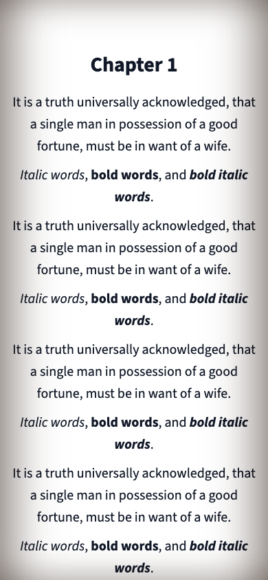

# TextStack typography

## Roles

- TextStack: wordmark, headings, book titles and serif reading mode. Native screens bundle the four supplied TTF styles; web and the WebView use compressed WOFF2 versions.
- Source Sans 3: interface text and sans reading mode. Web uses the existing Google Fonts delivery convention; native screens bundle Regular, Medium and Semibold from Adobe's release branch with the SIL OFL license.
- OpenDyslexic: existing accessibility option, unchanged.
- New reading defaults: 20px / 1.6. Existing storage keys and saved preferences are preserved; 1.65 spacing remains selectable.

## Web

`--font-serif` and `--font-sans` define the two roles. TextStack uses WOFF2 `@font-face` declarations with `font-display: swap`, preloading Regular. Vite emits content-hashed URLs under `/assets/`, which already has one-year immutable caching in nginx. All four web fonts total 247,400 bytes, down from 976,604 bytes of TTF. No nginx/SEO changes are required. Georgia / Times New Roman / browser serif remain fallbacks. Reader chapter headings inherit the selected reader family.

## Native mobile and offline reader

Expo loads TextStack's four named styles and Source Sans 3's three interface weights for native screens. Shared typography tokens and existing literal font references use these registered names.

The WebView reader cannot use Expo's native font registry. `src/lib/readerFonts.generated.ts` stores compressed WOFF2 data by family. Each document includes **only the selected family**: TextStack 330,472 bytes, Source Sans 3 521,140 bytes, or the existing OpenDyslexic payload. A system-family document embeds no custom font data. The previous implementation included 1,877,830 bytes of font CSS in every standard document.

TextStack and Source Sans 3 both include real regular, italic, bold and bold italic faces. A family change uses the existing document rebuild/restore path, allowing the new fonts to load before restoring the saved text anchor. Size, alignment and spacing still update in place. Reflow documents retain their existing file-access policy and require no network for fonts. Original-layout PDFs are unchanged.

After changing compressed sources, run `pnpm -C apps/mobile build:reader-fonts`. TextStack WOFF2 sources live in `apps/web/src/assets/fonts/`; regenerate them with `woff2_compress` when replacing native TextStack TTFs. Source Sans 3 WOFF2 sources come from Adobe's official `WOFF2/TTF` release directory. Tests check signatures, generated-data consistency, selected-family isolation, payload size and position restoration during family switches. Unused Crimson Pro and Inter TTF assets were removed.

Android JS plus referenced assets export: **19.28 MB → 18.25 MB** uncompressed. This excludes the native runtime and is not an APK download or installed-size measurement. The native-font asset list remains the same seven files; unreferenced old fonts were not part of the export.

## Provenance and unresolved distribution rights

The user supplied files from `~/Downloads/TextStack Fonts/`. All four are byte-identical to the corresponding Michelangelus files in the [official Microsoft download](https://www.microsoft.com/en-us/download/details.aspx?id=108856). CSS exposes them as `TextStack`; internal font names remain unchanged.

The original download license grants no redistribution or sublicensing rights. No separate license permitting web or app redistribution has been supplied. Renaming the files does not establish those rights; release clearance remains unresolved.

Source Sans 3 files come from [Adobe's official release branch](https://github.com/adobe-fonts/source-sans/tree/release/TTF), with its license in `apps/mobile/assets/fonts/SourceSans3-LICENSE.md`.

## Verification — 2026-10-16

- Web production build passed; Vite reports a large-chunk warning. Full web suite: 129 files, 923 tests passed, 2 skipped.
- Mobile typecheck passed; full suite: 96 files, 796 tests passed.
- Expo exports for iOS and Android passed and include all seven registered native font assets.
- Chromium: web catalogue and reader at 1440px and 390px, light/dark; no horizontal overflow. Confirmed actual downloaded TextStack WOFF2 fonts, all four faces, alternate reader fonts and Georgia fallback.
- Chromium: generated mobile reader HTML at 390px, light/sepia/dark, with outbound requests blocked. TextStack and Source Sans 3 use real regular, bold, italic and bold italic files. All three reading families render with zero network requests and no horizontal overflow.
- Browser previews use sample API data; the local backend is unavailable. These previews validate the reader document, not a running iOS/Android device. Physical device QA, live backend flows and full language coverage remain unverified.

## Preview images

The screenshots show sample data. The mobile image is the native app's generated reader document rendered in Chromium, not a device screenshot.

